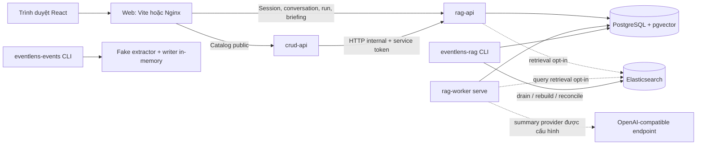

# EventLens — Contract API và các service hiện có

> Ngày đối chiếu: **03/11/2026**. Tài liệu mô tả implementation đang có trong worktree `rag-search-platform`, không phải một thiết kế tương lai hoặc chứng nhận production.

## Mục lục

1. [Phạm vi và nguồn đối chiếu](#1-phạm-vi-và-nguồn-đối-chiếu)
2. [Kiến trúc và trách nhiệm service](#2-kiến-trúc-và-trách-nhiệm-service)
3. [Quy ước contract chung](#3-quy-ước-contract-chung)
4. [API catalog public — CRUD API](#4-api-catalog-public--crud-api)
5. [API session, conversation và run — RAG API](#5-api-session-conversation-và-run--rag-api)
6. [API briefing và source viewer](#6-api-briefing-và-source-viewer)
7. [API nội bộ và giao tiếp service](#7-api-nội-bộ-và-giao-tiếp-service)
8. [Lỗi và cách xử lý phía frontend](#8-lỗi-và-cách-xử-lý-phía-frontend)
9. [Worker, CLI và dữ liệu đầu vào](#9-worker-cli-và-dữ-liệu-đầu-vào)
10. [Dữ liệu lưu ở đâu](#10-dữ-liệu-lưu-ở-đâu)
11. [Cấu hình và các môi trường chạy](#11-cấu-hình-và-các-môi-trường-chạy)
12. [Luồng tích hợp frontend](#12-luồng-tích-hợp-frontend)
13. [Giới hạn và chỗ dễ hiểu nhầm](#13-giới-hạn-và-chỗ-dễ-hiểu-nhầm)
14. [Phụ lục tham số HTTP](#14-phụ-lục-tham-số-http)
15. [Phụ lục schema HTTP](#15-phụ-lục-schema-http)
16. [Phụ lục schema dữ liệu nhập](#16-phụ-lục-schema-dữ-liệu-nhập)

## 1. Phạm vi và nguồn đối chiếu

**Code được đọc:**

```text
/Users/phungdinhdat/Documents/git/eventlens/.claude/worktrees/rag-search-platform
branch: feature/rag-search-platform
HEAD:   3fe5fc023117dc3c2f007fb5c5463461c5d8c6e0
```

Worktree có nhiều thay đổi chưa commit, gồm search platform, news backend và FE đang được bổ sung. Vì vậy HEAD ở trên **không đại diện toàn bộ implementation** được mô tả. File này được đặt ở `docs/` của checkout chính để dễ đọc; các đường dẫn source trong nội dung được tính từ root worktree nói trên.

Đã thực hiện khi viết tài liệu:

- Đọc route, DTO, exception handler, use case, composition, worker, migration và Compose.
- Xuất OpenAPI từ các app hiện hành vào thư mục tạm; không cần DB/model/network.
- So sánh bản xuất với `docs/openapi/`: hai bản khớp về nội dung.
- Chưa chạy lại toàn bộ test, chưa smoke Docker hoặc gọi model trong công việc viết tài liệu này. Cổng bên dưới là **cấu hình**, không có nghĩa service đang chạy.

Nguồn chính:

- [CRUD OpenAPI](../docs/openapi/crud-api.openapi.json).
- [RAG OpenAPI](../docs/openapi/rag-api.openapi.json).
- [Hướng dẫn news backend](../docs/news-backend.md).
- [DTO catalog dùng chung](../src/backend/shared/contracts/catalog.py).
- [Route conversation/run](../src/backend/rag/presentation/conversations_http.py).
- [Route briefing/source](../src/backend/rag/presentation/briefing_http.py).

OpenAPI hiện có: **8 path/8 operation của CRUD**, **19 path/20 operation của RAG**. Tính theo service, tổng cộng 28 operation: 7 catalog public, 10 session/chat, 2 briefing/source, 7 catalog internal và 2 health. `/docs`, `/redoc`, `/openapi.json` do FastAPI cung cấp mặc định không nằm trong số operation nghiệp vụ này.

## 2. Kiến trúc và trách nhiệm service

### 2.1 Sơ đồ tổng thể



Đây là một codebase chia module theo nghiệp vụ, có nhiều process triển khai. Không phải mọi folder đều là một HTTP service. CRUD theo Clean Architecture; RAG có domain/application/ports/infra/presentation và workflow LangGraph. Shared contracts chỉ là package Python nội bộ, không phải server.

### 2.2 Danh sách thành phần

| Thành phần | Entry point / nơi định nghĩa | Cổng trong container | Trách nhiệm | Trạng thái thực tế |
|---|---|---:|---|---|
| Web | `src/frontend/web`, Vite/Nginx | Nginx 80 | UI và gateway cùng origin | Đã có code FE mới; chưa nghiệm thu FE trong tài liệu này |
| CRUD API | `backend.crud.main:app` | 8000 | Catalog public: list/detail/summary/facets/taxonomy | Gọi RAG qua HTTP, không giữ DB bài riêng |
| RAG API | `backend.rag.api_main:app` | 8001 | Catalog internal, session/chat/run, briefing, nguồn | Đọc/ghi PostgreSQL; cần DB cho news API |
| RAG worker | `eventlens-rag-worker serve` | Không có HTTP | Chạy query run, summary, đồng bộ nhãn | Queue bền vững trong PostgreSQL; model tùy cấu hình |
| RAG CLI | `eventlens-rag` | Không có HTTP | Migration/import/index/evaluation/diagnostics | Lệnh quản trị và thử nghiệm; không cho FE gọi trực tiếp |
| Event pipeline | `eventlens-events` | Không có HTTP | Validate bundle, demo trích xuất/gate event | Fake extractor + in-memory writer; chưa lưu event vào PostgreSQL |
| PostgreSQL | Image pgvector PostgreSQL 17 trong Compose | 5432 | Nguồn dữ liệu chuẩn, queue, lexical/vector, chat | SQLAlchemy + Alembic |
| Elasticsearch | Compose search riêng, image 9.2.0 | 9200 | Bản chiếu tìm kiếm BM25/semantic | Tùy chọn, không phải nguồn dữ liệu chuẩn |
| MinIO | Service `minio`, profile `infra` | 9000 / console 9001 | Hạ tầng object storage dự kiến | Có container config; không được suy ra pipeline production đang dùng |
| LLM endpoint | Dịch vụ ngoài, không phải service mặc định của Compose | Tùy endpoint | Summary thật hoặc benchmark Ollama | Live chat chưa có implementation hoàn chỉnh |

`crud-api` hiện chủ yếu là **catalog read API**, dù module có tên CRUD. Chưa có public API tạo/sửa/xóa bài, quản trị nhãn hoặc kích hoạt crawl.

### 2.3 Quyền sở hữu dữ liệu

- RAG sở hữu bài, revision, provenance, chunks, index generation, nhãn, summary, job, session, conversation, run và citation.
- CRUD sở hữu các use case/route catalog public; dữ liệu đi qua `ArticleCatalogPort` → `RagCatalogHttp` → RAG internal API.
- Frontend chỉ gọi API public. Không kết nối PostgreSQL/Elasticsearch, không biết service token.
- Elasticsearch chỉ đề xuất candidate; PostgreSQL kiểm revision hiện hành, tombstone và scope trước khi dùng evidence.
- Event pipeline là context riêng; không đồng nhất `eventlens-events process` với RAG ingestion hoặc worker chat.

## 3. Quy ước contract chung

### 3.1 Định dạng, version và trường dữ liệu

- HTTP body là JSON; request có body dùng `Content-Type: application/json`.
- JSON array tương ứng tuple trong DTO Python.
- Các body DTO chính từ chối field lạ (`extra=forbid`). Điều này không có nghĩa mọi query parameter lạ đều bị từ chối.
- Response dùng `schema_version`, ví dụ `article_list.v1`, `query_run.v1`.
- Body tạo conversation và gửi run **không nhận** `schema_version`. Riêng `/briefing` bắt buộc có `schema_version: briefing_request.v1`.
- Trường bắt buộc nhưng nullable phải có key và có thể bằng `null`. Không coi `null`, thiếu field và mảng rỗng là tương đương.
- Phụ lục 14–16 liệt kê field, required/default, enum và giới hạn từ schema.

### 3.2 Các loại định danh

| Field | Kiểu | Ý nghĩa |
|---|---|---|
| `article_id` | UUID | Định danh bài, dùng xuyên các revision |
| `article_version_id` trong API | `sha256:` + 64 hex chữ thường | Revision key của RAG, gắn nội dung đã chuẩn hóa |
| `article_version_id` trong file handoff | UUID | Version do bên dữ liệu cấp; **khác kiểu/ý nghĩa với field cùng tên ở API** |
| `upstream_version_id` trong API | UUID hoặc null | Version upstream được giữ để truy vết |
| `source.id` / `source_ids` | UUID | Định danh nhà xuất bản; không phải hostname |
| `source_domain` / `source_domains` | string hostname | Dùng ở legacy briefing; khác source UUID |
| `conversation_id`, `run_id`, `citation_id`, `claim_id` | UUID | Định danh các tài nguyên chat/answer |
| `source_ref` | Opaque token | Vé mở source viewer; không phải article ID |
| `cursor` | Opaque string | Vị trí phân trang; client giữ nguyên |

### 3.3 Thời gian và đoạn trích

- Catalog dùng thời gian **nguồn đăng bài**, không lấy `fetched_at` thay `published_at`.
- Timestamp filter phải có offset. Response catalog xuất UTC.
- Khoảng thời gian là `[published_after, published_before)`: gồm đầu, không gồm cuối.
- Ví dụ ngày 29/10/2026 tại Việt Nam: từ `2026-10-28T17:00:00Z` đến trước `2026-10-29T17:00:00Z`.
- Bài không có `published_at` vẫn có thể xuất hiện khi không lọc thời gian; được xếp cuối và không khớp filter có biên thời gian.
- Offset trích dẫn tính theo **Unicode code point trên đúng văn bản NFC**, end-exclusive; không phải byte, grapheme hay UTF-16 index của JavaScript.
- FE có thể dùng `Array.from(content).slice(start_offset, end_offset).join("")` để đối chiếu excerpt. Không trim/decode entity hoặc chuẩn hóa lại text trước khi áp offset.
- Đoạn trích đúng hash/offset chỉ chứng minh đoạn tồn tại, không tự chứng minh claim đúng ngữ nghĩa.

### 3.4 Xác thực và header

| Nhóm API | Xác thực hiện có |
|---|---|
| Catalog public của CRUD | Không yêu cầu session/token người dùng |
| Tạo session | Không cần session trước đó |
| Conversation/run/cấp lại source ref | Cookie `eventlens_session` hoặc `Authorization: Bearer <session_token>` |
| Xóa session hiện tại | Thu hồi token nếu có; xóa cookie; không yêu cầu principal dependency |
| Catalog internal của RAG | Bearer service token cấu hình trên server |
| Legacy `/briefing` và source viewer | `CallerResolver`; composition hiện dùng fixture caller cố định, không phải session owner |

Bearer header có giá trị sẽ được ưu tiên hơn cookie. Session tồn tại 7 ngày; DB lưu SHA-256 token. `POST /sessions` tạo owner/token mới mỗi lần, không phải “get-or-create session”.

Cookie: HttpOnly, SameSite=Lax, path `/`; Secure khi `EVENTLENS_RAG_SESSION_COOKIE_SECURE=1`. Không đọc cookie bằng JavaScript. Cấu hình API hiện chưa có CORS; web tích hợp qua gateway cùng origin.

`X-Request-ID`: API nhận giá trị hợp lệ theo `^[A-Za-z0-9-]{8,64}$`, nếu không hợp lệ thì sinh mới; trả lại header response. Lưu ý adapter CRUD → RAG hiện không chuyển request ID từ request public, nên không mặc định coi đó là distributed trace xuyên service.

Session ẩn danh chỉ tách ownership hội thoại; chưa phải tài khoản đăng nhập hay ACL cho corpus riêng tư. Cấp source ref yêu cầu ownership, nhưng GET viewer dùng caller policy hiện hành, không kiểm owner cookie như route conversation.

## 4. API catalog public — CRUD API

Base trực tiếp mặc định: `http://127.0.0.1:8000`. Khi qua web dùng relative URL cùng origin.

| Method | Path | Thành công | Response |
|---|---|---:|---|
| GET | `/health` | 200 | `HealthResponse` |
| GET | `/api/v1/articles` | 200 | `ArticleListV1` |
| GET | `/api/v1/articles/{article_id}` | 200 | `ArticleDetailV1` |
| GET | `/api/v1/articles/{article_id}/summary` | 200 | `ArticleSummaryV1` |
| GET | `/api/v1/article-facets` | 200 | `ArticleFacetsV1` |
| GET | `/api/v1/topics` | 200 | `TopicListV1` |
| GET | `/api/v1/locations` | 200 | `LocationListV1` |
| GET | `/api/v1/sources` | 200 | `SourceListV1` |

### 4.1 Danh sách bài

`GET /api/v1/articles`

| Query | Giới hạn / mặc định | Ngữ nghĩa |
|---|---|---|
| `q` | Tối đa 200 ký tự | PostgreSQL lexical trên tiêu đề + nội dung |
| `topic_ids` | Tối đa 20 giá trị | Mã topic từ taxonomy |
| `location_ids` | Tối đa 20 giá trị | Mã địa phương từ gazetteer |
| `source_ids` | Tối đa 20 UUID | Nguồn báo |
| `published_after` | Datetime có offset | Biên đầu, inclusive |
| `published_before` | Datetime có offset | Biên cuối, exclusive |
| `include_descendants` | `true` | Địa phương gồm các đơn vị con trong gazetteer |
| `sort` | `relevance` nếu có q, nếu không `latest` | `latest`, `oldest`, `relevance` |
| `cursor` | Tối đa 1024 ký tự | Opaque next cursor |
| `limit` | 1–50, mặc định 20 | Số bài mỗi trang |

OR trong cùng loại filter; AND giữa các loại. Ví dụ `topic_ids=economy&topic_ids=health&location_ids=vn-ho-chi-minh` nghĩa là economy **hoặc** health, đồng thời thuộc địa phương đã chọn. Không gửi danh sách dưới dạng chuỗi comma-separated.

`relevance` không có q bị từ chối. `latest/oldest` dùng published_at và article_id để phá hòa; relevance dùng rank trước. Catalog tìm kiếm dùng PostgreSQL `simple`/`websearch_to_tsquery`, chưa tách từ tiếng Việt hoặc bỏ dấu; không tự chuyển sang hybrid khi bật hybrid cho chatbot.

Response card gồm title, publisher, URL, published_at, labels, summary_preview và processing_status; **không có full text, ảnh hoặc số lượt đọc**. Một item là một bài hiện hành, không phải chunk.

Ví dụ request:

```http
GET /api/v1/articles?q=giao%20th%C3%B4ng&sort=relevance&limit=20&topic_ids=transportation
```

Ví dụ response không có kết quả (JSON minh họa hợp lệ, không phải dữ liệu production):

```json
{
  "schema_version": "article_list.v1",
  "items": [],
  "next_cursor": null,
  "has_more": false,
  "as_of": "2026-11-03T00:00:00Z",
  "search_mode": "lexical"
}
```

List không có `total`. Lấy số lượng qua facets khi cần. Đổi filter/sort phải bỏ cursor. Cursor catalog được HMAC ký và gắn filter/sort; sai → `invalid_cursor` hoặc `cursor_mismatch`.

**Nhất quán:** một response đọc bằng transaction REPEATABLE READ và dựng card theo đúng revision đã chọn. Các trang hoặc request list/facets/detail riêng biệt không chia sẻ snapshot; dữ liệu có thể đổi giữa chúng.

### 4.2 Chi tiết bài

`GET /api/v1/articles/{article_id}?article_version_id=sha256:...`

- Path là UUID. Query version tùy chọn, dùng để phát hiện bài đã đổi, không phải để lấy lịch sử revision.
- Response có `article`, `content`, `content_policy`, thời gian nhập/cập nhật nguồn, language, version và labels kèm provenance.
- `content_policy=full`: nội dung plain text chuẩn hóa; `withheld`: `content=null`.
- `version.is_current` luôn true; `revision_count >= 1`.
- Không biết ID → `404 article_not_found`; tombstone → `410 article_gone`.
- Pinned version không còn hiện hành → `409 article_version_stale`; reason chứa version hiện hành.

Các nhãn có `provenance=enrichment|manual`, `model_version`, `confidence`, `review_status`. Không hiểu một nhãn model là đã được người duyệt chỉ vì nó xuất hiện trong API.

### 4.3 Tóm tắt bài

`GET /api/v1/articles/{article_id}/summary`

Không có request body hoặc tham số chọn model. Không có `article_version_id` query ở route này. GET chỉ đọc kết quả đã lưu, không gọi model hoặc tự enqueue.

| `status` | Nghĩa | FE nên làm |
|---|---|---|
| `ready` | Đã có summary của revision hiện hành | Hiện text/key_points và căn cứ |
| `pending` | Job đang chờ/xử lý | Hiện trạng thái, poll có backoff khi phù hợp |
| `failed` | Job thất bại | Hiện thông báo theo `failure_code`; không tự tạo admin request |
| `unavailable` | Không có summary/job tương ứng | Hiện chưa khả dụng |

Response luôn `source="ai"`; fixture cũng dùng cấu trúc này. Nhận biết fixture qua `generator.model_id` như `fixture-summarizer`, không suy luận “model thật” từ `source=ai`.

Mỗi key point có supporting_spans với offset, excerpt và fingerprint. Summary/detail được gọi riêng: FE phải so `article_version_id` trước khi highlight. Nếu lệch, tải lại hoặc báo đã cập nhật.

`publisher_summary` hiện null với handoff đang hỗ trợ vì dữ liệu chưa cung cấp sapo. Provider summary `none` làm job chờ tiếp; không hứa pending sẽ tự chuyển ready nếu chưa cấu hình worker/model.

### 4.4 Facets và taxonomy

`GET /api/v1/article-facets` nhận đúng **các filter**, không nhận sort/cursor/limit để phân trang. Response có total, topic counts, location counts, source counts, topics_unclassified, locations_unknown và as_of.

`semantics=all_filters_applied`: áp cả filter của chính chiều đang đếm. Ví dụ chọn topic A thì topic facet vẫn được tính trên tập đã lọc A. Không cộng tổng các facet để suy ra total: một bài có thể mang nhiều nhãn.

- `/topics`: không query; trả taxonomy_version và items `{id,name,name_en}`.
- `/locations`: `parent_id?`, `q?` tối đa 200 ký tự, `limit` 1–100 mặc định 100; lookup alias/prefix theo code hiện có. Không có cursor.
- `/sources`: không query; trả publisher và article_count của các bài hiện hành. Không phải facet count của filter feed đang chọn.

Gazetteer đang đóng gói `vn-admin-2025.v1`: country, municipality, province, former_province. Đây là mô tả dữ liệu seed trong repository, không phải tuyên bố cập nhật tự động mọi thay đổi hành chính sau đó. FE lấy ID từ API.

Metadata chỉ được chiếu từ publication có model trong trusted list hoặc nhãn manual. Fake enrichment mặc định không đáng tin; topic/location trống với unavailable là trạng thái có chủ đích.

## 5. API session, conversation và run — RAG API

Base trực tiếp mặc định: `http://127.0.0.1:8001`.

| Method | Path | Thành công | Body → Response |
|---|---|---:|---|
| POST | `/api/v1/sessions` | 201 | Không body → `SessionOut` |
| DELETE | `/api/v1/sessions/current` | 204 | Không body → không body |
| POST | `/api/v1/conversations` | 201 | `CreateConversationIn` → `ConversationOut` |
| GET | `/api/v1/conversations` | 200 | Query → `ConversationListOut` |
| GET | `/api/v1/conversations/{conversation_id}/messages` | 200 | Query → `MessagesOut` |
| DELETE | `/api/v1/conversations/{conversation_id}` | 204 | Không body |
| POST | `/api/v1/conversations/{conversation_id}/runs` | 202 | `SubmitRunIn` → `RunAcceptedOut` |
| GET | `/api/v1/runs/{run_id}` | 200 | Không body → `RunOut` |
| POST | `/api/v1/runs/{run_id}/cancel` | 202 | Không body → `RunOut` |
| POST | `/api/v1/runs/{run_id}/citations/{citation_id}/source-ref` | 201 | Không body → `SourceRefOut` |

### 5.1 Session và ownership

Tạo session trả token một lần trong JSON đồng thời đặt cookie. Có thể dùng cookie cho web và Bearer cho script. Đừng gọi POST sessions mỗi lần mở trang; nó tạo owner mới và khiến cookie cũ bị thay thế.

Tài nguyên không tồn tại, bị xóa hoặc của owner khác trả 404. Server không dùng `X-User-ID` hoặc owner client tự khai. Body có field lạ có thể bị validation từ chối.

Không có GET session hiện tại, refresh-token API hoặc API đăng nhập tài khoản. FE có thể thử list conversations bằng cookie hiện có, xử lý 401 rồi tạo session khi cần. Xóa session là thu hồi truy cập; không đồng nghĩa xóa vật lý toàn bộ conversation.

### 5.2 Tạo conversation và scope

Body bắt buộc `scope`, tùy chọn `title` (tối đa 200 ký tự). Ba dạng:

```json
{"scope":{"type":"all"},"title":"Hỏi đáp tin tức"}
```

```json
{
  "scope": {
    "type": "filtered",
    "filters": {
      "topic_ids": ["transportation"],
      "location_ids": ["vn-ho-chi-minh"],
      "include_descendants": true,
      "published_after": "2026-10-28T17:00:00Z",
      "published_before": "2026-10-29T17:00:00Z"
    }
  }
}
```

```json
{
  "scope": {
    "type": "articles",
    "articles": [{"article_id":"11111111-1111-4111-8111-111111111111"}]
  }
}
```

UUID cuối chỉ minh họa; phải lấy ID tồn tại từ catalog.

| Scope | Quy tắc |
|---|---|
| `all` | Không có filters, articles rỗng |
| `filtered` | Bắt buộc filters; không có articles; dùng semantics catalog, không chứa sort/limit/cursor |
| `articles` | 1–20 article pin; không lặp article_id; không có filters |

Mỗi article pin có optional `article_version_id`. Version đã cũ ngay lúc tạo → `400 invalid_scope`, reason `scope_stale`. Đổi sau khi tạo → run failed `scope_stale`, không âm thầm đổi nguồn.

Conversation giữ **định nghĩa scope**, không giữ cố định toàn bộ tập bài của một thời điểm. Run resolve lại scope theo revision hiện hành; filtered dùng toàn bộ tập khớp, không chỉ trang feed đang mở; giới hạn tập filtered 5.000 bài. Run ghi effective_scope/as_of/source_versions để truy vết.

Response `ConversationOut.scope` được khai báo object mở trong OpenAPI; shape canonical thực tế có `type`, `filters` và `articles`. Scope_sha256 là digest định nghĩa, không phải token xác thực.

Không có API đổi scope, sửa title hay GET conversation detail riêng. Đọc header conversation qua list hoặc messages. Muốn hỏi theo scope khác, tạo conversation mới.

### 5.3 Danh sách và lịch sử

- List: `limit=20` mặc định, 1–50; `cursor?` tối đa 200 ký tự. Sắp mới tạo trước. Cursor conversation khác cursor catalog, không dùng lẫn nhau.
- Messages: `after_sequence=0` mặc định, không âm; `limit=50`, 1–100.
- `MessagesOut` có conversation header, items và next_after_sequence. Nếu trả đủ limit, next_after_sequence có thể dẫn tới một trang cuối rỗng; đọc theo contract thay vì tự đoán tổng.
- Message chứa text/role/sequence/run_id, không chứa toàn bộ citations và trạng thái run. Khi cần đáp án có nguồn hoặc khôi phục run, lấy `GET /runs/{run_id}`.
- Conversation delete soft-delete; queued runs bị hủy, running runs được đặt cancel flag. Chưa có retention job xóa vật lý theo lịch.

### 5.4 Submit run và idempotency

```http
POST /api/v1/conversations/{conversation_id}/runs
Content-Type: application/json
Idempotency-Key: client-generated-key-001

{"question":"Bài viết cho biết thay đổi giao thông nào?"}
```

Question 1–2.000 ký tự; sau trim phải không rỗng. Không nhận model, top-k, context budget hoặc scope trong body này.

`Idempotency-Key` **optional trong implementation**, nhưng FE nên luôn gửi. Nếu có: 1–200 ký tự ASCII in được, không có khoảng trắng. UUID là lựa chọn thích hợp.

- Cùng owner + conversation + key và question đã trim giống nhau → trả run cũ, `replayed=true`, header `Idempotent-Replayed: true`.
- Cùng key nhưng question khác → `409 idempotency_key_reused`.
- Conversation đang có run active → `409 run_in_progress`.
- Submit ghi user message + run + job trong một transaction.
- `Location` header và `status_url` cùng trỏ `/api/v1/runs/{id}`.
- HTTP 202 chỉ xác nhận đã nhận/replay run; status trong response có thể đã terminal nếu replay run cũ.
- Provider `none` ở API → 503 model_unavailable ngay khi submit, không phải một đáp án abstained.
- Provider `live` có thể nhận job nhưng worker hiện chưa có live synthesizer, nên không suy ra live hoạt động chỉ từ HTTP 202.

### 5.5 Poll và lifecycle

```text
queued ──> running ──> completed + outcome answered hoặc abstained
   │           ├────> failed + error.code/reason
   │           └────> cancelled
   └───────────────> cancelled
```

`GET /runs/{id}` thành công đọc tài nguyên trả HTTP 200 **kể cả status=failed**. Lỗi thực thi nằm trong `error`, khác lỗi HTTP khi không đọc được run.

Response có question, status/outcome, answer, citations, effective_scope, as_of, source_versions, usage, cancel_requested và thời gian lifecycle. Các field chưa có giá trị trả null hoặc array rỗng theo schema.

`answer.answer` là text; `answer.claims` là các claim; citations nằm ở **top-level `run.citations`**, nối qua claim_id. `answer.audit`, effective_scope và usage chưa có schema con đầy đủ trong OpenAPI: client không nên giả định field nội bộ không được contract hóa.

Model/storage failure phải là failed, không biến thành “không có tin”. Poll theo terminal status, tránh request chồng; không có SSE/WebSocket hoặc stream token.

Hội thoại ngắn có history policy `previous-question-concat.v1`: nếu câu hỏi tối đa 12 từ, retrieval có thể ghép câu hỏi user trước. Câu trả lời trước không trở thành evidence; đây chưa phải bộ nhớ hội thoại tổng quát bằng LLM.

### 5.6 Hủy, retry và worker recovery

- POST cancel trả 202 và trạng thái thật.
- Queued → cancelled ngay; running → `cancel_requested=true` rồi worker hủy cooperative.
- Gọi model đang diễn ra không được đảm bảo ngắt tức thì.
- Đóng tab/ngắt HTTP **không hủy** durable run.
- Worker claim lease 60 giây, tối đa 3 lần thử, queue deadline 600 giây theo cấu hình code hiện tại.
- Mỗi claim reconcile job terminal/missing với run non-terminal để tránh conversation mắc kẹt.
- Retry HTTP dùng lại key của cùng ý định gửi; không tự sinh key mới mỗi lần mạng lỗi.

### 5.7 Citation đã lưu và cấp lại source ref

Gọi POST source-ref bằng session sở hữu run. Server kiểm ownership, quyền đọc, revision và excerpt hiện hành, rồi trả source_ref + viewer_url.

```json
{
  "schema_version": "source_ref.v1",
  "source_ref": "opaque-example-token",
  "viewer_url": "/briefing/sources/opaque-example-token"
}
```

GET viewer_url để lấy văn bản nguồn. Source-ref PostgreSQL có TTL 24 giờ. Ref hết hạn/lạ → `404 source_not_found` ở viewer; có thể xin ref mới nếu citation/revision vẫn hợp lệ. Bài sửa/xóa → 410 source_stale; quyền bị thu hồi → 403 access_denied. Không tự chuyển citation sang bản mới.

## 6. API briefing và source viewer

### 6.1 `POST /briefing`

API đồng bộ một câu, không tạo conversation history hoặc durable query run. Giữ tương thích luồng trước news backend.

```json
{
  "schema_version": "briefing_request.v1",
  "query": "Có thông tin nào về giao thông?",
  "publication_time_basis": "source_published_at",
  "source_domains": [],
  "topic_filters": [],
  "entity_ids": [],
  "context_budget": 12000,
  "result_limit": 5
}
```

Các field bổ sung: published_after/published_before optional; query 1–2.000 ký tự có ký tự không trắng; mỗi filter list tối đa 20; result_limit 1–20; context_budget integer 1–12.000.

Không nhận caller, policy hoặc model từ client. Nguồn caller hiện là fixture resolver; activation mặc định fixture. Có API key trong environment không tự bật model thật.

200 `BriefingResponse` có outcome:

- `answered`
- `abstained_no_evidence`
- `abstained_by_model`

Khác run API vốn dùng status `completed` và outcome `answered|abstained`. Legacy citations chứa `source_ref` trực tiếp; chat citations chứa `source_ref_url` cần POST để cấp ref.

Audit legacy là object có các field cố định: policy/index/chunker/model/tokenizer versions, trạng thái retrieval/rerank/coverage và usage. Xem schema `AuditMetadata` ở phụ lục.

### 6.2 `GET /briefing/sources/{source_ref}`

Path ref tối đa 64 ký tự. Thành công trả `SourceResponse`:

- title, source_name/domain/url/published_at;
- normalized_content;
- span `{start_offset,end_offset,excerpt}`.

Không có article_id/article_version_id trong response viewer này. Chat citation đã lưu có các ID đó riêng. Viewer kiểm ref/caller, tombstone, hash và span trước khi trả nguồn.

### 6.3 Các bất biến câu trả lời

Backend validation yêu cầu claim có citation, ID không trùng và uncertainty trỏ claim hợp lệ. Temporal claim có evidence_span_ids và luật known/unknown, start/end, relative expression/reference_at/timezone. Một số luật liên trường nằm trong domain validator, không thể biểu diễn đầy đủ chỉ bằng các kiểu OpenAPI.

Client có thể kiểm schema/quan hệ hiển thị nhưng không thay thế kiểm chứng ngữ nghĩa. Không coi citation liên kết hợp lệ là bằng chứng rằng model diễn giải đúng đoạn.

## 7. API nội bộ và giao tiếp service

### 7.1 Mapping public → internal

Tất cả internal route là GET trên rag-api, yêu cầu Bearer service token.

| Public trên CRUD | Internal trên RAG |
|---|---|
| `/api/v1/articles` | `/internal/v1/catalog/articles` |
| `/api/v1/articles/{article_id}` | `/internal/v1/catalog/articles/{article_id}` |
| `/api/v1/articles/{article_id}/summary` | `/internal/v1/catalog/articles/{article_id}/summary` |
| `/api/v1/article-facets` | `/internal/v1/catalog/facets` |
| `/api/v1/topics` | `/internal/v1/catalog/topics` |
| `/api/v1/locations` | `/internal/v1/catalog/locations` |
| `/api/v1/sources` | `/internal/v1/catalog/sources` |

Body response catalog giống nhau, dùng shared DTO. Internal q ở khai báo HTTP cho phép 400 ký tự, nhưng domain catalog vẫn giới hạn 200 sau chuẩn hóa; FE dùng contract public tối đa 200, không coi 400 là tính năng bổ sung.

Auth internal thiếu cấu hình → `503 internal_auth_not_configured`; token sai/thiếu khi đã cấu hình → `401 service_unauthenticated`.

CRUD adapter: timeout mặc định 3 giây, không retry tự động, circuit breaker mở sau 5 lỗi liên tiếp trong 10 giây; không follow redirect. Upstream 400/404/409/410 hợp lệ được giữ status/code. Upstream auth/network/error khác → 503 catalog_unavailable. Body sai contract → 502 catalog_contract_mismatch. Không dùng mảng rỗng để che lỗi.

### 7.2 Gateway web

Worktree hiện đã bổ sung route nhóm catalog → CRUD và session/conversation/run/briefing → RAG vào Vite/Nginx. Đây là thay đổi mới so với `docs/news-backend.md` mục 7 vốn còn nói chỉ proxy `/briefing`.

Intended routing:

```text
/api/v1/{articles,article-facets,topics,locations,sources} -> crud-api:8000
/api/v1/{sessions,conversations,runs}                    -> rag-api:8001
/briefing                                              -> rag-api:8001
/internal/*                                            -> deny
/news, /articles/<id>, /chat/<id>                        -> frontend SPA
```

Tài liệu này chưa smoke gateway và không xác nhận cấu hình proxy mới đã chạy đúng. Contract chuẩn ở trên được đối chiếu trực tiếp từ route backend. Khi tích hợp phải kiểm request qua **cổng web**, không chỉ gọi thẳng API. Response API không được bị SPA fallback đổi thành HTML.

### 7.3 Health và tài liệu tự động

Hai API đều có GET /health → `{"status":"ok"}`. Handler không ping DB, worker, ES hay provider. Chỉ coi là liveness của HTTP process, không phải readiness toàn hệ thống.

FastAPI còn cung cấp `/docs`, `/redoc`, `/openapi.json` trực tiếp trên mỗi API. Không mặc định coi chúng được proxy qua web.

## 8. Lỗi và cách xử lý phía frontend

### 8.1 Envelope `/api/v1` và `/internal/v1`

```json
{
  "schema_version": "api_error.v1",
  "error": {
    "code": "cursor_mismatch",
    "reason": null,
    "request_id": "example-request-001"
  }
}
```

Reason có thể null hoặc string theo tình huống; không hiển thị raw traceback/upstream body. CRUD response 503 có `Retry-After: 5`; không suy ra mọi 503 từ RAG đều có header đó.

| HTTP | Code thường gặp | Ý nghĩa / xử lý |
|---:|---|---|
| 400 | `invalid_request` | Sai type, UUID, format, field lạ hoặc giới hạn DTO |
| 400 | `timezone_required`, `invalid_publication_range`, `query_too_long` | Sửa filter |
| 400 | `unknown_topic_id`, `unknown_location_id`, `invalid_sort`, `relevance_requires_query` | Tải taxonomy/kiểm lựa chọn |
| 400 | `invalid_cursor`, `cursor_mismatch` | Bỏ cursor cũ, tải lại trang đầu |
| 400 | `invalid_scope`, `invalid_question` | Sửa câu hỏi/scope; xem reason |
| 401 | `unauthenticated` | Session thiếu/hết hạn/thu hồi |
| 401 | `service_unauthenticated` | Lỗi nội bộ; FE không được xin service token |
| 403 | `access_denied` | Không còn quyền truy cập nguồn |
| 404 | `article_not_found`, `conversation_not_found`, `run_not_found`, `citation_not_found`, `not_found` | Không có hoặc không thuộc owner |
| 405 | `method_not_allowed` | Sai method đối với API v1/internal |
| 409 | `article_version_stale` | Bài đã đổi; tải revision hiện hành khi người dùng chấp nhận |
| 409 | `idempotency_key_reused`, `run_in_progress` | Không gửi trùng/sửa key tùy tiện |
| 410 | `article_gone`, `source_stale` | Bài/nguồn đã mất hoặc thay đổi |
| 502 | `catalog_contract_mismatch` | CRUD nhận body RAG không hợp lệ |
| 503 | `catalog_unavailable`, `conversation_storage_unavailable`, `retrieval_unavailable` | Hạ tầng tạm không đáp ứng; retry phù hợp |
| 503 | `model_unavailable` | Provider chưa cấu hình/chưa hỗ trợ hoặc gặp lỗi |
| 503 | `internal_auth_not_configured` | Backend thiếu cấu hình service auth |

Danh sách mã không phải enum kín trong OpenAPI; FE cần fallback cho code chưa biết và giữ request_id để hỗ trợ chẩn đoán.

### 8.2 Legacy briefing error

Envelope `briefing_error.v1` có `error.code` và `error.reason`, không có request_id trong body (header request ID vẫn có trên RAG app).

| HTTP | Code mapped từ lỗi typed |
|---:|---|
| 400 | `invalid_request`, `invalid_query` |
| 401 | `unauthenticated` |
| 403 | `access_denied` |
| 404 | `source_not_found` |
| 408 | `request_cancelled`, `deadline_exceeded` |
| 409 | `evidence_stale` |
| 410 | `source_stale` |
| 422 | `budget_exceeded` |
| 429 | `capacity_exceeded` |
| 500 | `configuration_invalid`, `internal_error` |
| 502 | `invalid_grounded_answer` |
| 503 | `retrieval_unavailable`, `model_unavailable` |

404/405 do framework ngoài `/api/` và `/internal/` có thể dùng envelope mặc định `detail`; không tuyên bố mọi lỗi trên mọi URL đều là briefing_error.v1.

### 8.3 Lỗi HTTP khác lỗi thực thi run

`GET /runs/{id}` có thể trả HTTP 200 với status failed và error.code như `deadline_exceeded`, `scope_stale`, `scope_too_large`, `budget_exceeded`, `invalid_grounded_answer`, `model_unavailable`. Đây là trạng thái job, không phải status HTTP cần chuyển thành 4xx/5xx ở client.

### 8.4 Điểm OpenAPI chưa mô tả đủ

- FastAPI tự sinh response validation 422. Exception handler thực tế đổi RequestValidationError thành **400** với envelope của nhóm route. Riêng legacy 422 budget_exceeded vẫn tồn tại.
- OpenAPI chat/internal chưa khai báo đầy đủ tất cả error response và cơ chế Bearer/cookie/service-token dưới security scheme.
- Quy tắc scope liên trường, idempotency, ownership, cursor, snapshot và span nằm trong code/use case.
- Các object như RunOut.usage/effective_scope và AnswerOut.audit có mức chặt khác nhau; không tự coi chúng là schema giống AuditMetadata của `/briefing`.
- Các envelope được đảm bảo cho lỗi đã mapping; không có cơ sở nói mọi exception chưa xử lý đều được chuẩn hóa.

## 9. Worker, CLI và dữ liệu đầu vào

### 9.1 RAG worker — không phải HTTP service

| Lệnh | Chức năng |
|---|---|
| `eventlens-rag-worker ingest BUNDLE_PATH` | Validate ArticleBundle, persist bài và enqueue enrichment |
| `eventlens-rag-worker enrich` | Chạy lượt enrichment, provider hiện fake/fake-timeout |
| `eventlens-rag-worker sync-labels` | Chiếu nhãn trusted/manual sang catalog |
| `eventlens-rag-worker summary-requeue --article-id UUID` | Quản trị retry/schedule summary |
| `eventlens-rag-worker summarize` | Chạy lượt job summary |
| `eventlens-rag-worker runs` | Chạy lượt query run |
| `eventlens-rag-worker serve` | Loop query pool + summary pool + label sync |

Serve mặc định query_workers=2, summary_workers=1, poll_seconds=1, label_sync_seconds=30. Nếu summary provider none thì không start summary pool. Serve hiện **không tự chạy enrich hoặc drain ES outbox**; các phần đó cần lệnh/lịch riêng.

Summary trigger tạo job khi revision trở thành current; summary graph chuẩn bị → gọi model → validate → kiểm current → publish. Giới hạn 24.000 ký tự đầu vào; quá dài thất bại, không cắt âm thầm. Provider timeout 60 giây; retry transient theo policy. Requeue là lệnh quản trị, chưa có nút/API public tương đương.

### 9.2 RAG CLI

| Nhóm | Lệnh hiện có | Phạm vi |
|---|---|---|
| Migration | `migrate`, `preflight`, `adopt-legacy` | Alembic/legacy adoption có kiểm tra |
| Dữ liệu | `load-fixtures`, `handoff-validate`, `handoff-import` | Fixture hoặc batch bên dữ liệu |
| PG index | `rebuild`, `vector-route-report` | Generation/vector diagnostics |
| ES projection | `index rebuild`, `index reconcile`, `index health`, `index drain-outbox` | Đồng bộ PG → ES |
| Smoke | `retrieval-smoke`, `synthesis-smoke`, `db-test` | Kiểm tra kỹ thuật |
| Eval | `enrichment-eval`, `rag-eval`, `search-eval` | Benchmark và gate |
| Nhãn/diagnosis | `search-review-sheet`, `search-label-audit`, `search-eval-diagnose` | Chuẩn bị/kiểm nhãn, phân tích trace |
| QA Ollama | `ollama-bench`, `ollama-bench-report` | Evaluation riêng, không phải transport chat live |

Xem `--help` của từng lệnh để lấy flag chính xác. Đây không phải public API; FE không được chạy shell thay API.

### 9.3 Batch bên dữ liệu

Đầu vào importer hiện có:

```text
articles.jsonl     Một HandoffArticle cho mỗi dòng UTF-8
manifest.json      HandoffManifest, kiểm checksum/count/provenance của batch
```

`RAG_DATA_DIFFERENCES_AND_ERROR_RISKS.md` là tài liệu giải thích chất lượng/chênh lệch dữ liệu, không phải request body hoặc file bắt buộc mà importer tự parse.

Handoff schema `eventlens-rag-handoff-v1` có bài, nguồn, thời gian, hash/parser/normalization, quality và identity upstream. Không bắt bên dữ liệu cung cấp embedding/chunk/summary/topic/location; đó là phần downstream. Toàn bộ field được liệt kê ở phụ lục 16.

Importer:

- Kiểm bytes/SHA-256/count và thống kê manifest.
- Chuẩn hóa NFC cho RAG; giữ cả hash upstream và hash RAG, không yêu cầu chúng bằng nhau.
- Không lấy fetched_at thay ngày đăng.
- Giữ provenance để nối revision upstream với citation.
- Import batch trong transaction; xung đột version/content/parser/normalization thì từ chối và rollback.
- Có idempotency khi nhập lại cùng dữ liệu.
- `handoff-import` hiện giới hạn DB tên đuôi `_eval`; chưa phải đường ingest production tổng quát.

`ArticleBundle` là contract khác dùng cho worker ingest/event pipeline: `{article, media}`; media_count phải khớp, media.article_id đúng bài, media_id duy nhất, position liên tục từ 0. Không tự bịa raw fetch/media metadata để đổi handoff thành bundle.

### 9.4 Event pipeline

`eventlens-events validate` kiểm bundle; `process` chạy fake extraction → gate ACCEPT/REJECT/REVIEW → InMemoryEventWriter. Writer reset theo lần gọi CLI; chưa có event HTTP API hoặc DB event production. MinIO reader, model extractor và writer bền vững vẫn là phần chưa nối theo code/docs hiện có.

## 10. Dữ liệu lưu ở đâu

SQLAlchemy nằm trong infra; Alembic quản lý schema. Chuyển sang SQLAlchemy không có nghĩa mọi query đều ORM: các query lexical/vector/phức tạp vẫn có SQL chuyên dụng chạy qua Engine/transaction.

| Nhóm | Bảng chính | Mục đích |
|---|---|---|
| Bài/revision | `rag_article_documents`, `rag_article_current` | Nội dung revision và con trỏ current/tombstone |
| Provenance | `rag_source_versions` | Mapping upstream version/hash/parser về revision RAG |
| PG index | `rag_index_generations`, `rag_chunks` | Generation và chunk/lexical/vector |
| Enrichment | `rag_enrichment_jobs`, `rag_enrichment_versions`, `rag_enrichment_publications` | Job, kết quả versioned, publication |
| Source viewer | `rag_source_references` | Hash token, caller, revision, span, expiry |
| Search platform | `rag_search_generations`, `rag_search_outbox`, `rag_search_embedding_cache` | ES generation, đồng bộ có retry/fence, cache embedding |
| Taxonomy | `rag_topics`, `rag_locations`, `rag_location_aliases` | Chủ đề/địa phương/alias |
| Nhãn bài | `rag_article_labels`, `rag_label_syncs` | Nhãn theo revision, provenance và trạng thái sync |
| Summary/queue | `rag_article_summaries`, `rag_work_jobs` | Summary và durable job summary/query_run |
| Session/chat | `rag_sessions`, `rag_conversations`, `rag_query_runs`, `rag_messages`, `rag_run_citations` | Ownership, lịch sử, trạng thái run, evidence identity |
| Schema | `alembic_version`, `rag_schema_migrations` | Revision Alembic và ledger lịch sử |

Chain hiện có:

```text
rag_0001_baseline
  → rag_0002_source_versions
  → rag_0003_search_platform
  → rag_0004_news_backend
```

PostgreSQL vector lịch sử là vector(1536); search platform có identity embedding riêng, BGE-M3 1024 chiều khi bật. Không trộn vector khác model/revision/dimension. ES projection có fencing/version để chống write cũ ghi đè revision mới; index không trở thành nơi quyết định quyền/revision nguồn.

## 11. Cấu hình và các môi trường chạy

### 11.1 Biến server quan trọng

| Biến | Process | Mặc định / ý nghĩa |
|---|---|---|
| `EVENTLENS_API_RAG_DATABASE_URL` | RAG API | Không đặt: legacy fixture; news catalog/chat thiếu DB trả lỗi |
| `EVENTLENS_RAG_DATABASE_URL` | Worker/CLI | DSN DB RAG |
| `EVENTLENS_RAG_EVAL_DATABASE_URL` | Import/evaluation | DSN DB thử nghiệm, guard `_eval` cho handoff |
| `EVENTLENS_RAG_INTERNAL_SERVICE_TOKEN` | RAG API | Service auth internal catalog |
| `EVENTLENS_CRUD_RAG_SERVICE_TOKEN` | CRUD API | Cùng giá trị với token RAG |
| `EVENTLENS_CRUD_RAG_CATALOG_URL` | CRUD API | `http://127.0.0.1:8001`, trong Docker dùng hostname service |
| `EVENTLENS_CRUD_RAG_TIMEOUT_SECONDS` | CRUD API | 3 giây |
| `EVENTLENS_RAG_CURSOR_SECRET` | RAG API | Ít nhất 32 byte; nếu thiếu sinh ngẫu nhiên mỗi process |
| `EVENTLENS_RAG_SESSION_COOKIE_SECURE` | RAG API | `0`; đặt `1` sau HTTPS |
| `EVENTLENS_RAG_CATALOG_CONTENT` | RAG API | `full` hoặc `withheld` |
| `EVENTLENS_RAG_ANSWER_PROVIDER` | RAG API + worker | `none`, `fixture`, `live`; live chưa có synthesizer hoàn chỉnh |
| `EVENTLENS_RAG_SUMMARY_PROVIDER` | Worker | `none`, `fixture`, `openai-compatible` |
| `EVENTLENS_RAG_SUMMARY_BASE_URL` | Worker | Base URL của summary provider |
| `EVENTLENS_RAG_SUMMARY_MODEL` | Worker | Model ID |
| `EVENTLENS_RAG_SUMMARY_MODEL_VERSION` | Worker | Identity/version cố định |
| `EVENTLENS_RAG_SUMMARY_API_KEY` | Worker | Optional secret |
| `EVENTLENS_RAG_TRUSTED_ENRICHMENT_MODELS` | Worker | Danh sách model_version phân cách comma; mặc định không tin model nào |
| `EVENTLENS_RAG_SEARCH_BACKEND` | RAG API/worker | `postgres`; `elasticsearch` là opt-in |
| `EVENTLENS_RAG_SEARCH_FALLBACK` | RAG API/worker | `postgres` hoặc `none` |
| `EVENTLENS_RAG_ELASTICSEARCH_URL`, `EVENTLENS_RAG_ELASTICSEARCH_API_KEY` | Search runtime | Endpoint/credential ES |
| `EVENTLENS_RAG_SEARCH_EMBEDDINGS` | Search runtime | `none`, `fake-bge-m3`, `bge-m3` |
| `EVENTLENS_RAG_BGE_M3_REVISION` | Search runtime | Bắt buộc khi dùng bge-m3 |
| `EVENTLENS_RAG_RERANK`, `EVENTLENS_RAG_RERANK_REVISION` | Search runtime | Mặc định off; cross-encoder cần revision |
| `EVENTLENS_RAG_MULTI_HOP` | Search runtime | Mặc định off |
| `EVENTLENS_RAG_RETRIEVAL_TUNING` | Search runtime | Mặc định baseline |
| `EVENTLENS_CRUD_API_URL`, `EVENTLENS_RAG_API_URL` | Vite server | Target proxy dev; không phải biến public trong bundle |

Không đưa DSN/service token/provider key vào `VITE_*`. API và worker phải cùng DB và cấu hình provider tương thích; API nhận job không có nghĩa worker đã đủ cấu hình để thực thi.

### 11.2 Root Compose

`compose.yaml` có crud-api 8000, rag-api 8001, web 5173→80. PostgreSQL/MinIO ở profile infra; rag-worker/event-pipeline ở profile tools.

Rag-worker trong root Compose mặc định chạy `enrich --max-jobs 5`, **không phải serve lâu dài**. Muốn chat async có worker, chạy serve riêng hoặc dùng cấu hình news-demo.

Root Compose publish port API/web không có ràng buộc loopback như news-demo. Không nhầm cấu hình dev này với cấu hình public deployment an toàn.

### 11.3 News demo bền vững — cấu hình mới trong worktree

`docker/news-demo.compose.yaml`, script `scripts/news/demo.sh`:

| Thành phần | Host port mặc định | Ghi chú |
|---|---:|---|
| Web | 18080 | `http://127.0.0.1:18080/news` |
| CRUD | 18000 | Direct API |
| RAG | 18001 | Direct API |
| PostgreSQL | 55442 | DB `eventlens_news_eval` |
| Worker | Không có | Command serve |

Project `eventlens-news-demo`, named volume `news-demo-pg` (Compose thêm project prefix), secret file `.private/news-demo.env`. Không in hoặc commit file secret. Mode mặc định none; fixture phải bật rõ.

Các lệnh đã có trong script; tài liệu này chỉ đối chiếu code, chưa chạy lại chúng:

```sh
# Chạy từ root worktree rag-search-platform
rtk proxy sh scripts/news/demo.sh up
rtk proxy sh scripts/news/demo.sh import
rtk proxy sh scripts/news/demo.sh status

# Chỉ bật khi muốn demo câu trả lời/tóm tắt giả có nhãn fixture:
rtk proxy sh scripts/news/demo.sh mode fixture

# Trở lại trạng thái AI chưa cấu hình:
rtk proxy sh scripts/news/demo.sh mode none

# Giữ dữ liệu trong volume:
rtk proxy sh scripts/news/demo.sh stop
```

Import đọc thư mục `NEWS_DEMO_HANDOFF_DIR` trong env file (mặc định Downloads). Không dùng lệnh `down -v` nếu cần giữ dữ liệu.

### 11.4 Search/evaluation

`docker/search-eval.compose.yaml` tách khỏi project root/news-demo: ES 9.2.0 single node, localhost host port ngẫu nhiên nếu không chỉ định, memory limit mặc định 1536m/heap 512m. PostgreSQL eval có profile riêng và tmpfs. Đây không phải DB demo bền vững. ES config này tắt security để thử nghiệm cục bộ, không áp dụng nguyên xi cho public deployment.

## 12. Luồng tích hợp frontend

### 12.1 Feed → bài → summary

1. Lấy taxonomy/source để dựng filter, không hardcode ID.
2. GET articles và facets với cùng filter; xử lý hai as_of độc lập.
3. Click bài → GET detail; có thể pin version đang hiển thị trên card.
4. GET summary, so article_version_id trước khi hiển thị căn cứ trên detail.
5. Pending thì polling theo UI; unavailable/failed có thông báo riêng.

### 12.2 Chat có nguồn

1. Dùng cookie hiện tại; tạo session khi thực sự cần.
2. POST conversation với scope rõ ràng.
3. POST run với question và Idempotency-Key.
4. Poll status_url đến completed/failed/cancelled.
5. Hiển thị answer/claims, ghép citations bằng claim_id.
6. POST citation.source_ref_url để cấp ref; GET viewer_url.
7. Nếu nguồn stale, giữ citation lịch sử và đánh dấu lỗi thời; không thay bằng nội dung mới.

### 12.3 Request mẫu bằng curl

Các ID phải lấy từ response thật; không có endpoint “chat” chung nhận tất cả một lần.

```sh
# Direct services mặc định; đổi cổng nếu dùng news-demo.
rtk proxy curl -sS 'http://127.0.0.1:8000/api/v1/articles?limit=5'
rtk proxy curl -sS 'http://127.0.0.1:8000/api/v1/article-facets'
rtk proxy curl -sS 'http://127.0.0.1:8000/api/v1/topics'

# Cookie jar là thông tin nhạy cảm, giữ private, không commit.
rtk proxy curl -sS -c /private/tmp/eventlens-session.cookies \
  -X POST 'http://127.0.0.1:8001/api/v1/sessions'

rtk proxy curl -sS -b /private/tmp/eventlens-session.cookies \
  -H 'Content-Type: application/json' \
  -d '{"scope":{"type":"all"},"title":"Tin tức"}' \
  'http://127.0.0.1:8001/api/v1/conversations'

# Thay CONVERSATION_UUID bằng ID response; yêu cầu provider không phải none.
rtk proxy curl -sS -b /private/tmp/eventlens-session.cookies \
  -H 'Content-Type: application/json' -H 'Idempotency-Key: example-request-001' \
  -d '{"question":"Các bài viết nói gì về giao thông?"}' \
  'http://127.0.0.1:8001/api/v1/conversations/CONVERSATION_UUID/runs'

rtk proxy curl -sS -b /private/tmp/eventlens-session.cookies \
  'http://127.0.0.1:8001/api/v1/runs/RUN_UUID'
```

Trong browser dùng URL relative, không copy DSN hoặc service token. Chỉ gọi status_url/source_ref_url/viewer_url thuộc origin/path được phép, tránh gửi cookie tới URL tùy ý.

## 13. Giới hạn và chỗ dễ hiểu nhầm

| Có trong code | Chưa nên hiểu thành |
|---|---|
| SQLAlchemy + Alembic, API/worker + queue | Đã adopt mọi DB vận hành hoặc deployment production đã được nghiệm thu |
| Chat fixture và run lifecycle | Chat live đã nối model thật |
| Summary OpenAI-compatible adapter | Đã cấu hình endpoint và chứng minh chất lượng summary |
| Session ownership | Tài khoản/OIDC hoặc ACL corpus riêng tư |
| Taxonomy và label sync | 200 bài hiện đã được gắn chủ đề/địa phương đáng tin |
| PG/ES hybrid opt-in | Hybrid là default hoặc đã được chọn tối ưu trên dữ liệu người duyệt |
| Source offsets/fingerprints đúng | Tất cả claim được hỗ trợ về mặt ngữ nghĩa |
| Worker serve chạy | Enrichment và ES outbox drain tự động chạy cùng |
| GET health ok | DB, worker, ES và model đều khỏe |
| Proxy rules mới trong worktree | Gateway đã được smoke/FE nghiệm thu trong lần lập tài liệu này |

**Default retrieval giữ PostgreSQL**, tuning baseline; ES hybrid opt-in, RRF k=60 và trọng số 1:1, cap cơ bản 3 span/bài; các thử nghiệm freshness/fill/rerank/multi-hop không tự trở thành default.

Hiện không có public endpoint upload/crawl/import bài, quản trị nhãn, tạo summary ngay, đổi scope/title hội thoại, list runs độc lập, SSE/WebSocket, user account hoặc story/event graph API. Muốn thêm phải mở rộng contract, không “đoán URL” từ chức năng mong muốn.

Phần dưới là tham chiếu chi tiết được trích từ schema hiện tại. Required/nullable/enum giữ theo code; những invariant chỉ có ở domain được giải thích ở các mục phía trên.

## 14. Phụ lục tham số HTTP

Trích từ OpenAPI vừa xuất lại. Status lỗi OpenAPI chưa đầy đủ; đọc mục 8 cho handler runtime. Xác thực thủ công trong route không xuất hiện thành `security` ở đây.

### crud-api

#### `GET /api/v1/article-facets`

Body: không có body được khai báo.

Thành công: HTTP 200: [ArticleFacetsV1](#schema-articlefacetsv1).

| Tham số | Vị trí | Bắt buộc | Kiểu | Giới hạn/default |
|---|---|---|---|---|
| `q` | query | Không | string hoặc null | độ dài ≤ `200` |
| `topic_ids` | query | Không | array&lt;string&gt; hoặc null | số phần tử ≤ `20`; Mỗi phần tử: regex `"^[a-z0-9_-]{1,80}$"` |
| `location_ids` | query | Không | array&lt;string&gt; hoặc null | số phần tử ≤ `20`; Mỗi phần tử: regex `"^[a-z0-9_-]{1,80}$"` |
| `source_ids` | query | Không | array&lt;string (uuid)&gt; hoặc null | số phần tử ≤ `20` |
| `published_after` | query | Không | string (date-time) hoặc null | ISO-8601 with offset, inclusive |
| `published_before` | query | Không | string (date-time) hoặc null | ISO-8601 with offset, exclusive |
| `include_descendants` | query | Không | boolean | mặc định `true` |

#### `GET /api/v1/articles`

Body: không có body được khai báo.

Thành công: HTTP 200: [ArticleListV1](#schema-articlelistv1).

| Tham số | Vị trí | Bắt buộc | Kiểu | Giới hạn/default |
|---|---|---|---|---|
| `sort` | query | Không | `"latest"` / `"oldest"` / `"relevance"` hoặc null | — |
| `cursor` | query | Không | string hoặc null | độ dài ≤ `1024` |
| `limit` | query | Không | integer | giá trị ≥ `1`; giá trị ≤ `50`; mặc định `20` |
| `q` | query | Không | string hoặc null | độ dài ≤ `200` |
| `topic_ids` | query | Không | array&lt;string&gt; hoặc null | số phần tử ≤ `20`; Mỗi phần tử: regex `"^[a-z0-9_-]{1,80}$"` |
| `location_ids` | query | Không | array&lt;string&gt; hoặc null | số phần tử ≤ `20`; Mỗi phần tử: regex `"^[a-z0-9_-]{1,80}$"` |
| `source_ids` | query | Không | array&lt;string (uuid)&gt; hoặc null | số phần tử ≤ `20` |
| `published_after` | query | Không | string (date-time) hoặc null | ISO-8601 with offset, inclusive |
| `published_before` | query | Không | string (date-time) hoặc null | ISO-8601 with offset, exclusive |
| `include_descendants` | query | Không | boolean | mặc định `true` |

#### `GET /api/v1/articles/{article_id}`

Body: không có body được khai báo.

Thành công: HTTP 200: [ArticleDetailV1](#schema-articledetailv1).

| Tham số | Vị trí | Bắt buộc | Kiểu | Giới hạn/default |
|---|---|---|---|---|
| `article_id` | path | Có | string (uuid) | — |
| `article_version_id` | query | Không | string hoặc null | regex `"^sha256:[0-9a-f]{64}$"` |

#### `GET /api/v1/articles/{article_id}/summary`

Body: không có body được khai báo.

Thành công: HTTP 200: [ArticleSummaryV1](#schema-articlesummaryv1).

| Tham số | Vị trí | Bắt buộc | Kiểu | Giới hạn/default |
|---|---|---|---|---|
| `article_id` | path | Có | string (uuid) | — |

#### `GET /api/v1/locations`

Body: không có body được khai báo.

Thành công: HTTP 200: [LocationListV1](#schema-locationlistv1).

| Tham số | Vị trí | Bắt buộc | Kiểu | Giới hạn/default |
|---|---|---|---|---|
| `parent_id` | query | Không | string hoặc null | regex `"^[a-z0-9-]{1,80}$"` |
| `q` | query | Không | string hoặc null | độ dài ≤ `200` |
| `limit` | query | Không | integer | giá trị ≥ `1`; giá trị ≤ `100`; mặc định `100` |

#### `GET /api/v1/sources`

Body: không có body được khai báo.

Thành công: HTTP 200: [SourceListV1](#schema-sourcelistv1).

Không có path/query/header parameter được khai báo trong OpenAPI. Cookie/Bearer xem mục 3 và 5.

#### `GET /api/v1/topics`

Body: không có body được khai báo.

Thành công: HTTP 200: [TopicListV1](#schema-topiclistv1).

Không có path/query/header parameter được khai báo trong OpenAPI. Cookie/Bearer xem mục 3 và 5.

#### `GET /health`

Body: không có body được khai báo.

Thành công: HTTP 200: [HealthResponse](#schema-healthresponse).

Không có path/query/header parameter được khai báo trong OpenAPI. Cookie/Bearer xem mục 3 và 5.

### rag-api

#### `GET /api/v1/conversations`

Body: không có body được khai báo.

Thành công: HTTP 200: [ConversationListOut](#schema-conversationlistout).

| Tham số | Vị trí | Bắt buộc | Kiểu | Giới hạn/default |
|---|---|---|---|---|
| `limit` | query | Không | integer | giá trị ≥ `1`; giá trị ≤ `50`; mặc định `20` |
| `cursor` | query | Không | string hoặc null | độ dài ≤ `200` |

#### `POST /api/v1/conversations`

Body: [CreateConversationIn](#schema-createconversationin) — bắt buộc.

Thành công: HTTP 201: [ConversationOut](#schema-conversationout).

Không có path/query/header parameter được khai báo trong OpenAPI. Cookie/Bearer xem mục 3 và 5.

#### `DELETE /api/v1/conversations/{conversation_id}`

Body: không có body được khai báo.

Thành công: HTTP 204: không body.

| Tham số | Vị trí | Bắt buộc | Kiểu | Giới hạn/default |
|---|---|---|---|---|
| `conversation_id` | path | Có | string (uuid) | — |

#### `GET /api/v1/conversations/{conversation_id}/messages`

Body: không có body được khai báo.

Thành công: HTTP 200: [MessagesOut](#schema-messagesout).

| Tham số | Vị trí | Bắt buộc | Kiểu | Giới hạn/default |
|---|---|---|---|---|
| `conversation_id` | path | Có | string (uuid) | — |
| `after_sequence` | query | Không | integer | giá trị ≥ `0`; mặc định `0` |
| `limit` | query | Không | integer | giá trị ≥ `1`; giá trị ≤ `100`; mặc định `50` |

#### `POST /api/v1/conversations/{conversation_id}/runs`

Body: [SubmitRunIn](#schema-submitrunin) — bắt buộc.

Thành công: HTTP 202: [RunAcceptedOut](#schema-runacceptedout).

| Tham số | Vị trí | Bắt buộc | Kiểu | Giới hạn/default |
|---|---|---|---|---|
| `conversation_id` | path | Có | string (uuid) | — |
| `Idempotency-Key` | header | Không | string hoặc null | độ dài ≤ `200` |

#### `GET /api/v1/runs/{run_id}`

Body: không có body được khai báo.

Thành công: HTTP 200: [RunOut](#schema-runout).

| Tham số | Vị trí | Bắt buộc | Kiểu | Giới hạn/default |
|---|---|---|---|---|
| `run_id` | path | Có | string (uuid) | — |

#### `POST /api/v1/runs/{run_id}/cancel`

Body: không có body được khai báo.

Thành công: HTTP 202: [RunOut](#schema-runout).

| Tham số | Vị trí | Bắt buộc | Kiểu | Giới hạn/default |
|---|---|---|---|---|
| `run_id` | path | Có | string (uuid) | — |

#### `POST /api/v1/runs/{run_id}/citations/{citation_id}/source-ref`

Body: không có body được khai báo.

Thành công: HTTP 201: [SourceRefOut](#schema-sourcerefout).

| Tham số | Vị trí | Bắt buộc | Kiểu | Giới hạn/default |
|---|---|---|---|---|
| `run_id` | path | Có | string (uuid) | — |
| `citation_id` | path | Có | string (uuid) | — |

#### `POST /api/v1/sessions`

Body: không có body được khai báo.

Thành công: HTTP 201: [SessionOut](#schema-sessionout).

Không có path/query/header parameter được khai báo trong OpenAPI. Cookie/Bearer xem mục 3 và 5.

#### `DELETE /api/v1/sessions/current`

Body: không có body được khai báo.

Thành công: HTTP 204: không body.

Không có path/query/header parameter được khai báo trong OpenAPI. Cookie/Bearer xem mục 3 và 5.

#### `POST /briefing`

Body: [BriefingRequest](#schema-briefingrequest) — bắt buộc.

Thành công: HTTP 200: [BriefingResponse](#schema-briefingresponse).

Không có path/query/header parameter được khai báo trong OpenAPI. Cookie/Bearer xem mục 3 và 5.

#### `GET /briefing/sources/{source_ref}`

Body: không có body được khai báo.

Thành công: HTTP 200: [SourceResponse](#schema-sourceresponse).

| Tham số | Vị trí | Bắt buộc | Kiểu | Giới hạn/default |
|---|---|---|---|---|
| `source_ref` | path | Có | string | độ dài ≤ `64` |

#### `GET /health`

Body: không có body được khai báo.

Thành công: HTTP 200: [HealthResponse](#schema-healthresponse).

Không có path/query/header parameter được khai báo trong OpenAPI. Cookie/Bearer xem mục 3 và 5.

#### `GET /internal/v1/catalog/articles`

Body: không có body được khai báo.

Thành công: HTTP 200: [ArticleListV1](#schema-articlelistv1).

| Tham số | Vị trí | Bắt buộc | Kiểu | Giới hạn/default |
|---|---|---|---|---|
| `sort` | query | Không | `"latest"` / `"oldest"` / `"relevance"` hoặc null | — |
| `cursor` | query | Không | string hoặc null | độ dài ≤ `1024` |
| `limit` | query | Không | integer | giá trị ≥ `1`; giá trị ≤ `50`; mặc định `20` |
| `q` | query | Không | string hoặc null | độ dài ≤ `400` |
| `topic_ids` | query | Không | array&lt;string&gt; hoặc null | số phần tử ≤ `20` |
| `location_ids` | query | Không | array&lt;string&gt; hoặc null | số phần tử ≤ `20` |
| `source_ids` | query | Không | array&lt;string (uuid)&gt; hoặc null | số phần tử ≤ `20` |
| `published_after` | query | Không | string (date-time) hoặc null | — |
| `published_before` | query | Không | string (date-time) hoặc null | — |
| `include_descendants` | query | Không | boolean | mặc định `true` |

#### `GET /internal/v1/catalog/articles/{article_id}`

Body: không có body được khai báo.

Thành công: HTTP 200: [ArticleDetailV1](#schema-articledetailv1).

| Tham số | Vị trí | Bắt buộc | Kiểu | Giới hạn/default |
|---|---|---|---|---|
| `article_id` | path | Có | string (uuid) | — |
| `article_version_id` | query | Không | string hoặc null | regex `"^sha256:[0-9a-f]{64}$"` |

#### `GET /internal/v1/catalog/articles/{article_id}/summary`

Body: không có body được khai báo.

Thành công: HTTP 200: [ArticleSummaryV1](#schema-articlesummaryv1).

| Tham số | Vị trí | Bắt buộc | Kiểu | Giới hạn/default |
|---|---|---|---|---|
| `article_id` | path | Có | string (uuid) | — |

#### `GET /internal/v1/catalog/facets`

Body: không có body được khai báo.

Thành công: HTTP 200: [ArticleFacetsV1](#schema-articlefacetsv1).

| Tham số | Vị trí | Bắt buộc | Kiểu | Giới hạn/default |
|---|---|---|---|---|
| `q` | query | Không | string hoặc null | độ dài ≤ `400` |
| `topic_ids` | query | Không | array&lt;string&gt; hoặc null | số phần tử ≤ `20` |
| `location_ids` | query | Không | array&lt;string&gt; hoặc null | số phần tử ≤ `20` |
| `source_ids` | query | Không | array&lt;string (uuid)&gt; hoặc null | số phần tử ≤ `20` |
| `published_after` | query | Không | string (date-time) hoặc null | — |
| `published_before` | query | Không | string (date-time) hoặc null | — |
| `include_descendants` | query | Không | boolean | mặc định `true` |

#### `GET /internal/v1/catalog/locations`

Body: không có body được khai báo.

Thành công: HTTP 200: [LocationListV1](#schema-locationlistv1).

| Tham số | Vị trí | Bắt buộc | Kiểu | Giới hạn/default |
|---|---|---|---|---|
| `parent_id` | query | Không | string hoặc null | regex `"^[a-z0-9-]{1,80}$"` |
| `q` | query | Không | string hoặc null | độ dài ≤ `200` |
| `limit` | query | Không | integer | giá trị ≥ `1`; giá trị ≤ `100`; mặc định `100` |

#### `GET /internal/v1/catalog/sources`

Body: không có body được khai báo.

Thành công: HTTP 200: [SourceListV1](#schema-sourcelistv1).

Không có path/query/header parameter được khai báo trong OpenAPI. Cookie/Bearer xem mục 3 và 5.

#### `GET /internal/v1/catalog/topics`

Body: không có body được khai báo.

Thành công: HTTP 200: [TopicListV1](#schema-topiclistv1).

Không có path/query/header parameter được khai báo trong OpenAPI. Cookie/Bearer xem mục 3 và 5.

## 15. Phụ lục schema HTTP

Các schema chung giữa CRUD và RAG được gộp sau khi xác nhận cấu trúc giống nhau (HealthResponse khác docstring mô tả). “Bắt buộc: Có” là phải có key; kiểu có null vẫn được nhận null. Default vắng mặt trong OpenAPI không tự được diễn giải là có một default runtime. Mô tả tiếng Anh dưới tên schema lấy nguyên từ docstring code.

<a id="schema-answerout"></a>

### AnswerOut

Validated answer (no prompt, raw output or graph state).

Field ngoài schema: bị từ chối.

| Field | Bắt buộc | Kiểu / giá trị | Ràng buộc / default |
|---|---|---|---|
| `answer` | Có | string | — |
| `audit` | Có | map&lt;string, string&gt; | — |
| `claims` | Có | array&lt;[ClaimOut](#schema-claimout)&gt; | — |
| `mode` | Có | string | — |
| `model_version` | Có | string | — |
| `retrieval_mode` | Có | string | — |
| `retrieved_at` | Có | string (date-time) | — |
| `uncertainties` | Có | array&lt;[UncertaintyOut](#schema-uncertaintyout)&gt; | — |

<a id="schema-apierrordetail"></a>

### ApiErrorDetail

Stable code, optional enum reason, request correlation id.

Field ngoài schema: bị từ chối.

| Field | Bắt buộc | Kiểu / giá trị | Ràng buộc / default |
|---|---|---|---|
| `code` | Có | string | — |
| `reason` | Không | string hoặc null | — |
| `request_id` | Không | string hoặc null | — |

<a id="schema-apierrorv1"></a>

### ApiErrorV1

Error envelope of every ``/api/v1`` and ``/internal/v1`` route.

Field ngoài schema: bị từ chối.

| Field | Bắt buộc | Kiểu / giá trị | Ràng buộc / default |
|---|---|---|---|
| `error` | Có | [ApiErrorDetail](#schema-apierrordetail) | — |
| `schema_version` | Có | `"api_error.v1"` | — |

<a id="schema-articlecardv1"></a>

### ArticleCardV1

One current article (never a chunk); no full text.

Field ngoài schema: bị từ chối.

| Field | Bắt buộc | Kiểu / giá trị | Ràng buộc / default |
|---|---|---|---|
| `article_id` | Có | string (uuid) | — |
| `article_version_id` | Có | string | regex `"^sha256:[0-9a-f]{64}$"` |
| `locations` | Có | array&lt;[LocationLabel](#schema-locationlabel)&gt; | — |
| `processing_status` | Có | [ProcessingStatus](#schema-processingstatus) | — |
| `published_at` | Có | string (date-time) hoặc null | — |
| `source` | Có | [SourceInfo](#schema-sourceinfo) | — |
| `summary_preview` | Có | string hoặc null | — |
| `title` | Có | string | — |
| `topics` | Có | array&lt;[TopicLabel](#schema-topiclabel)&gt; | — |
| `upstream_version_id` | Có | string (uuid) hoặc null | — |
| `url` | Có | string | — |

<a id="schema-articledetailv1"></a>

### ArticleDetailV1

Current revision; ``content`` is the normalized plain text when allowed.

Field ngoài schema: bị từ chối.

| Field | Bắt buộc | Kiểu / giá trị | Ràng buộc / default |
|---|---|---|---|
| `article` | Có | [ArticleCardV1](#schema-articlecardv1) | — |
| `content` | Có | string hoặc null | — |
| `content_policy` | Có | `"full"` / `"withheld"` | — |
| `ingested_at` | Có | string (date-time) hoặc null | — |
| `labels` | Có | array&lt;[LabelProvenanceV1](#schema-labelprovenancev1)&gt; | — |
| `language` | Có | string hoặc null | — |
| `schema_version` | Có | `"article_detail.v1"` | — |
| `updated_at_source` | Có | string (date-time) hoặc null | — |
| `version` | Có | [VersionInfoV1](#schema-versioninfov1) | — |

<a id="schema-articlefacetsv1"></a>

### ArticleFacetsV1

Facet counts; location counts include descendants (gazetteer rollup).

Field ngoài schema: bị từ chối.

| Field | Bắt buộc | Kiểu / giá trị | Ràng buộc / default |
|---|---|---|---|
| `as_of` | Có | string (date-time) | — |
| `locations` | Có | array&lt;[FacetCountV1](#schema-facetcountv1)&gt; | — |
| `locations_unknown` | Có | integer | giá trị ≥ `0.0` |
| `schema_version` | Có | `"article_facets.v1"` | — |
| `semantics` | Có | `"all_filters_applied"` | — |
| `sources` | Có | array&lt;[FacetCountV1](#schema-facetcountv1)&gt; | — |
| `topics` | Có | array&lt;[FacetCountV1](#schema-facetcountv1)&gt; | — |
| `topics_unclassified` | Có | integer | giá trị ≥ `0.0` |
| `total` | Có | integer | giá trị ≥ `0.0` |

<a id="schema-articlelistv1"></a>

### ArticleListV1

Keyset page; ``next_cursor`` is opaque and bound to filters + sort.

Field ngoài schema: bị từ chối.

| Field | Bắt buộc | Kiểu / giá trị | Ràng buộc / default |
|---|---|---|---|
| `as_of` | Có | string (date-time) | — |
| `has_more` | Có | boolean | — |
| `items` | Có | array&lt;[ArticleCardV1](#schema-articlecardv1)&gt; | — |
| `next_cursor` | Có | string hoặc null | — |
| `schema_version` | Có | `"article_list.v1"` | — |
| `search_mode` | Có | `"none"` / `"lexical"` | — |

<a id="schema-articlepinin"></a>

### ArticlePinIn

One article of an ``articles`` scope.

Field ngoài schema: bị từ chối.

| Field | Bắt buộc | Kiểu / giá trị | Ràng buộc / default |
|---|---|---|---|
| `article_id` | Có | string (uuid) | — |
| `article_version_id` | Không | string hoặc null | regex `"^sha256:[0-9a-f]{64}$"` |

<a id="schema-articlesummaryv1"></a>

### ArticleSummaryV1

Stored summary state; reading it never calls a model.

Field ngoài schema: bị từ chối.

| Field | Bắt buộc | Kiểu / giá trị | Ràng buộc / default |
|---|---|---|---|
| `article_id` | Có | string (uuid) | — |
| `article_version_id` | Có | string | regex `"^sha256:[0-9a-f]{64}$"` |
| `created_at` | Có | string (date-time) hoặc null | — |
| `failure_code` | Có | string hoặc null | — |
| `generator` | Có | [SummaryGeneratorV1](#schema-summarygeneratorv1) hoặc null | — |
| `key_points` | Có | array&lt;[KeyPointV1](#schema-keypointv1)&gt; | — |
| `publisher_summary` | Có | string hoặc null | — |
| `schema_version` | Có | `"article_summary.v1"` | — |
| `source` | Có | `"ai"` | — |
| `status` | Có | `"ready"` / `"pending"` / `"failed"` / `"unavailable"` | — |
| `text` | Có | string hoặc null | — |

<a id="schema-auditmetadata"></a>

### AuditMetadata

Versions and counts that make one answer reproducible (no content).

Field ngoài schema: bị từ chối.

| Field | Bắt buộc | Kiểu / giá trị | Ràng buộc / default |
|---|---|---|---|
| `activation_policy_id` | Có | string | — |
| `chunker_version` | Có | string | — |
| `corpus_generation` | Có | string | — |
| `coverage_status` | Có | string | — |
| `draft_schema_version` | Có | string | — |
| `embedding_model` | Có | string | — |
| `embedding_version` | Có | string | — |
| `fusion_policy_id` | Có | string | — |
| `index_version` | Có | string | — |
| `input_tokens_charged` | Có | integer | — |
| `mode` | Có | `"fixture"` / `"live"` | — |
| `model_calls` | Có | integer | — |
| `output_tokens_charged` | Có | integer | — |
| `prompt_version` | Có | string | — |
| `rerank_status` | Có | string | — |
| `reranker_id` | Có | string hoặc null | — |
| `retrieval_policy_id` | Có | string | — |
| `synthesis_policy_id` | Có | string | — |
| `template_version` | Có | string | — |
| `tokenizer_id` | Có | string | — |
| `tokenizer_version` | Có | string | — |
| `usage_status` | Có | string | — |
| `vector_branch_status` | Có | string | — |

<a id="schema-briefingrequest"></a>

### BriefingRequest

Strict public request; caller identity and policy are server-owned.

Field ngoài schema: bị từ chối.

| Field | Bắt buộc | Kiểu / giá trị | Ràng buộc / default |
|---|---|---|---|
| `context_budget` | Không | integer | giá trị ≥ `1.0`; giá trị ≤ `12000.0`; mặc định `12000` |
| `entity_ids` | Không | array&lt;string (uuid)&gt; | số phần tử ≤ `20`; mặc định `[]` |
| `publication_time_basis` | Không | `"source_published_at"` | mặc định `"source_published_at"` |
| `published_after` | Không | string (date-time) hoặc null | — |
| `published_before` | Không | string (date-time) hoặc null | — |
| `query` | Có | string | độ dài ≥ `1`; độ dài ≤ `2000`; regex `"\\S"` |
| `result_limit` | Không | integer | giá trị ≥ `1.0`; giá trị ≤ `20.0`; mặc định `5` |
| `schema_version` | Có | `"briefing_request.v1"` | — |
| `source_domains` | Không | array&lt;string&gt; | số phần tử ≤ `20`; mặc định `[]`; Mỗi phần tử: độ dài ≤ `253`; regex `"^[a-z0-9.-]+$"` |
| `topic_filters` | Không | array&lt;`"business"` / `"technology"` / `"politics"` / `"economy"` / `"public_safety"` / `"weather"` / `"transportation"` / `"health"` / `"energy"` / `"environment"` / `"other"`&gt; | số phần tử ≤ `20`; mặc định `[]` |

<a id="schema-briefingresponse"></a>

### BriefingResponse

Public briefing answer; no prompt, raw output, graph state or lineage.

Field ngoài schema: bị từ chối.

| Field | Bắt buộc | Kiểu / giá trị | Ràng buộc / default |
|---|---|---|---|
| `abstention_reason` | Có | string hoặc null | — |
| `answer` | Có | string | — |
| `audit` | Có | [AuditMetadata](#schema-auditmetadata) | — |
| `citations` | Có | array&lt;[PublicCitation](#schema-publiccitation)&gt; | — |
| `claims` | Có | array&lt;[PublicClaim](#schema-publicclaim)&gt; | — |
| `model_version` | Có | string | — |
| `outcome` | Có | `"answered"` / `"abstained_no_evidence"` / `"abstained_by_model"` | — |
| `query_time_basis` | Có | `"source_published_at"` | — |
| `retrieval_mode` | Có | string | — |
| `retrieved_at` | Có | string (date-time) | — |
| `schema_version` | Có | `"briefing_response.v1"` | — |
| `uncertainties` | Có | array&lt;[PublicUncertainty](#schema-publicuncertainty)&gt; | — |

<a id="schema-citationout"></a>

### CitationOut

Persisted citation identity; open it through ``source_ref_url``.

Field ngoài schema: bị từ chối.

| Field | Bắt buộc | Kiểu / giá trị | Ràng buộc / default |
|---|---|---|---|
| `article_id` | Có | string (uuid) | — |
| `article_version_id` | Có | string | — |
| `citation_id` | Có | string (uuid) | — |
| `claim_id` | Có | string (uuid) | — |
| `source_domain` | Có | string | — |
| `source_name` | Có | string | — |
| `source_published_at` | Có | string (date-time) hoặc null | — |
| `source_ref_url` | Có | string | — |
| `source_title` | Có | string | — |
| `source_url` | Có | string | — |
| `span` | Có | [CitedSpanOut](#schema-citedspanout) | — |

<a id="schema-citedspanout"></a>

### CitedSpanOut

Cited span of the exact revision used.

Field ngoài schema: bị từ chối.

| Field | Bắt buộc | Kiểu / giá trị | Ràng buộc / default |
|---|---|---|---|
| `end_offset` | Có | integer | — |
| `excerpt` | Có | string | — |
| `start_offset` | Có | integer | — |

<a id="schema-claimout"></a>

### ClaimOut

Grounded claim.

Field ngoài schema: bị từ chối.

| Field | Bắt buộc | Kiểu / giá trị | Ràng buộc / default |
|---|---|---|---|
| `claim_id` | Có | string (uuid) | — |
| `temporal_claim` | Có | object mở hoặc null | — |
| `text` | Có | string | — |

<a id="schema-conversationlistout"></a>

### ConversationListOut

Owner's conversations, newest first.

Field ngoài schema: bị từ chối.

| Field | Bắt buộc | Kiểu / giá trị | Ràng buộc / default |
|---|---|---|---|
| `items` | Có | array&lt;[ConversationOut](#schema-conversationout)&gt; | — |
| `next_cursor` | Có | string hoặc null | — |
| `schema_version` | Có | `"conversation_list.v1"` | — |

<a id="schema-conversationout"></a>

### ConversationOut

Conversation header with its frozen scope definition.

Field ngoài schema: bị từ chối.

| Field | Bắt buộc | Kiểu / giá trị | Ràng buộc / default |
|---|---|---|---|
| `conversation_id` | Có | string (uuid) | — |
| `created_at` | Có | string (date-time) | — |
| `schema_version` | Có | `"conversation.v1"` | — |
| `scope` | Có | object mở | — |
| `scope_sha256` | Có | string | — |
| `title` | Có | string hoặc null | — |
| `updated_at` | Có | string (date-time) | — |

<a id="schema-createconversationin"></a>

### CreateConversationIn

``POST /api/v1/conversations``.

Field ngoài schema: bị từ chối.

| Field | Bắt buộc | Kiểu / giá trị | Ràng buộc / default |
|---|---|---|---|
| `scope` | Có | [ScopeIn](#schema-scopein) | — |
| `title` | Không | string hoặc null | độ dài ≤ `200` |

<a id="schema-errordetail"></a>

### ErrorDetail

Stable error code plus an optional enum reason.

Field ngoài schema: bị từ chối.

| Field | Bắt buộc | Kiểu / giá trị | Ràng buộc / default |
|---|---|---|---|
| `code` | Có | string | — |
| `reason` | Không | string hoặc null | — |

<a id="schema-errorresponse"></a>

### ErrorResponse

Error envelope.

Field ngoài schema: bị từ chối.

| Field | Bắt buộc | Kiểu / giá trị | Ràng buộc / default |
|---|---|---|---|
| `error` | Có | [ErrorDetail](#schema-errordetail) | — |
| `schema_version` | Có | `"briefing_error.v1"` | — |

<a id="schema-facetcountv1"></a>

### FacetCountV1

Distinct current articles with one label under all selected filters.

Field ngoài schema: bị từ chối.

| Field | Bắt buộc | Kiểu / giá trị | Ràng buộc / default |
|---|---|---|---|
| `count` | Có | integer | giá trị ≥ `0.0` |
| `domain` | Không | string hoặc null | — |
| `id` | Có | string | — |
| `name` | Có | string | — |
| `type` | Không | string hoặc null | — |

<a id="schema-httpvalidationerror"></a>

### HTTPValidationError

Field ngoài schema: không có ràng buộc `additionalProperties=false` tại cấp này trong OpenAPI.

| Field | Bắt buộc | Kiểu / giá trị | Ràng buộc / default |
|---|---|---|---|
| `detail` | Không | array&lt;[ValidationError](#schema-validationerror)&gt; | — |

<a id="schema-healthresponse"></a>

### HealthResponse

HTTP representation of rag-api readiness.

Field ngoài schema: không có ràng buộc `additionalProperties=false` tại cấp này trong OpenAPI.

| Field | Bắt buộc | Kiểu / giá trị | Ràng buộc / default |
|---|---|---|---|
| `status` | Có | `"ok"` | — |

<a id="schema-keypointv1"></a>

### KeyPointV1

Key point with its supporting spans.

Field ngoài schema: bị từ chối.

| Field | Bắt buộc | Kiểu / giá trị | Ràng buộc / default |
|---|---|---|---|
| `supporting_spans` | Có | array&lt;[SupportingSpanV1](#schema-supportingspanv1)&gt; | — |
| `text` | Có | string | — |

<a id="schema-labelprovenancev1"></a>

### LabelProvenanceV1

Provenance of one label of the current revision.

Field ngoài schema: bị từ chối.

| Field | Bắt buộc | Kiểu / giá trị | Ràng buộc / default |
|---|---|---|---|
| `confidence` | Có | number hoặc null | — |
| `id` | Có | string | — |
| `kind` | Có | `"topic"` / `"location"` | — |
| `match_method` | Có | string | — |
| `model_version` | Có | string hoặc null | — |
| `provenance` | Có | `"enrichment"` / `"manual"` | — |
| `review_status` | Có | `"unreviewed"` / `"approved"` / `"rejected"` | — |

<a id="schema-locationlabel"></a>

### LocationLabel

Location the article content is about (not the newsroom's location).

Field ngoài schema: bị từ chối.

| Field | Bắt buộc | Kiểu / giá trị | Ràng buộc / default |
|---|---|---|---|
| `id` | Có | string | — |
| `name` | Có | string | — |
| `type` | Có | string | — |

<a id="schema-locationlistv1"></a>

### LocationListV1

Gazetteer lookup result.

Field ngoài schema: bị từ chối.

| Field | Bắt buộc | Kiểu / giá trị | Ràng buộc / default |
|---|---|---|---|
| `gazetteer_version` | Có | string hoặc null | — |
| `items` | Có | array&lt;[LocationV1](#schema-locationv1)&gt; | — |
| `schema_version` | Có | `"location_list.v1"` | — |

<a id="schema-locationv1"></a>

### LocationV1

Gazetteer unit.

Field ngoài schema: bị từ chối.

| Field | Bắt buộc | Kiểu / giá trị | Ràng buộc / default |
|---|---|---|---|
| `aliases` | Có | array&lt;string&gt; | — |
| `id` | Có | string | — |
| `name` | Có | string | — |
| `parent_id` | Có | string hoặc null | — |
| `type` | Có | `"country"` / `"municipality"` / `"province"` / `"former_province"` | — |
| `valid_until` | Có | string hoặc null | — |

<a id="schema-messageout"></a>

### MessageOut

One message; assistant content is the validated answer text.

Field ngoài schema: bị từ chối.

| Field | Bắt buộc | Kiểu / giá trị | Ràng buộc / default |
|---|---|---|---|
| `content` | Có | string | — |
| `created_at` | Có | string (date-time) | — |
| `message_id` | Có | string (uuid) | — |
| `role` | Có | `"user"` / `"assistant"` | — |
| `run_id` | Có | string (uuid) | — |
| `sequence` | Có | integer | — |

<a id="schema-messagesout"></a>

### MessagesOut

History page.

Field ngoài schema: bị từ chối.

| Field | Bắt buộc | Kiểu / giá trị | Ràng buộc / default |
|---|---|---|---|
| `conversation` | Có | [ConversationOut](#schema-conversationout) | — |
| `items` | Có | array&lt;[MessageOut](#schema-messageout)&gt; | — |
| `next_after_sequence` | Có | integer hoặc null | — |
| `schema_version` | Có | `"message_list.v1"` | — |

<a id="schema-processingstatus"></a>

### ProcessingStatus

Derived-data states of the current revision.

Field ngoài schema: bị từ chối.

| Field | Bắt buộc | Kiểu / giá trị | Ràng buộc / default |
|---|---|---|---|
| `metadata` | Có | `"ready"` / `"pending"` / `"failed"` / `"unavailable"` | — |
| `summary` | Có | `"ready"` / `"pending"` / `"failed"` / `"unavailable"` | — |

<a id="schema-publiccitation"></a>

### PublicCitation

Citation with an opaque source reference for the viewer.

Field ngoài schema: bị từ chối.

| Field | Bắt buộc | Kiểu / giá trị | Ràng buộc / default |
|---|---|---|---|
| `citation_id` | Có | string (uuid) | — |
| `claim_id` | Có | string (uuid) | — |
| `source_domain` | Có | string | — |
| `source_name` | Có | string | — |
| `source_published_at` | Có | string (date-time) hoặc null | — |
| `source_ref` | Có | string | — |
| `source_title` | Có | string | — |
| `source_url` | Có | string | — |
| `span` | Có | [PublicCitedSpan](#schema-publiccitedspan) | — |

<a id="schema-publiccitedspan"></a>

### PublicCitedSpan

Cited span of the revision the answer was grounded on.

Field ngoài schema: bị từ chối.

| Field | Bắt buộc | Kiểu / giá trị | Ràng buộc / default |
|---|---|---|---|
| `end_offset` | Có | integer | — |
| `excerpt` | Có | string | — |
| `start_offset` | Có | integer | — |

<a id="schema-publicclaim"></a>

### PublicClaim

One grounded claim.

Field ngoài schema: bị từ chối.

| Field | Bắt buộc | Kiểu / giá trị | Ràng buộc / default |
|---|---|---|---|
| `claim_id` | Có | string (uuid) | — |
| `temporal_claim` | Có | [TemporalClaim](#schema-temporalclaim) hoặc null | — |
| `text` | Có | string | — |

<a id="schema-publicuncertainty"></a>

### PublicUncertainty

Server-templated uncertainty.

Field ngoài schema: bị từ chối.

| Field | Bắt buộc | Kiểu / giá trị | Ràng buộc / default |
|---|---|---|---|
| `category` | Có | string | — |
| `claim_id` | Có | string (uuid) hoặc null | — |
| `explanation` | Có | string | — |
| `uncertainty_id` | Có | string (uuid) | — |

<a id="schema-runacceptedout"></a>

### RunAcceptedOut

202 body of a submitted (or replayed) run.

Field ngoài schema: bị từ chối.

| Field | Bắt buộc | Kiểu / giá trị | Ràng buộc / default |
|---|---|---|---|
| `conversation_id` | Có | string (uuid) | — |
| `replayed` | Có | boolean | — |
| `run_id` | Có | string (uuid) | — |
| `schema_version` | Có | `"run_accepted.v1"` | — |
| `status` | Có | string | — |
| `status_url` | Có | string | — |

<a id="schema-runerrorout"></a>

### RunErrorOut

Stable failure code of a failed run.

Field ngoài schema: bị từ chối.

| Field | Bắt buộc | Kiểu / giá trị | Ràng buộc / default |
|---|---|---|---|
| `code` | Có | string | — |
| `reason` | Có | string hoặc null | — |

<a id="schema-runout"></a>

### RunOut

Run state; ``outcome`` only when ``status == completed``.

Field ngoài schema: bị từ chối.

| Field | Bắt buộc | Kiểu / giá trị | Ràng buộc / default |
|---|---|---|---|
| `abstention_reason` | Có | string hoặc null | — |
| `answer` | Có | [AnswerOut](#schema-answerout) hoặc null | — |
| `as_of` | Có | string (date-time) hoặc null | — |
| `cancel_requested` | Có | boolean | — |
| `citations` | Có | array&lt;[CitationOut](#schema-citationout)&gt; | — |
| `conversation_id` | Có | string (uuid) | — |
| `created_at` | Có | string (date-time) | — |
| `effective_scope` | Có | object mở hoặc null | — |
| `error` | Có | [RunErrorOut](#schema-runerrorout) hoặc null | — |
| `finished_at` | Có | string (date-time) hoặc null | — |
| `outcome` | Có | `"answered"` / `"abstained"` hoặc null | — |
| `question` | Có | string | — |
| `run_id` | Có | string (uuid) | — |
| `schema_version` | Có | `"query_run.v1"` | — |
| `sequence` | Có | integer | — |
| `source_versions` | Có | map&lt;string, string&gt; hoặc null | — |
| `started_at` | Có | string (date-time) hoặc null | — |
| `status` | Có | `"queued"` / `"running"` / `"completed"` / `"failed"` / `"cancelled"` | — |
| `usage` | Có | object mở hoặc null | — |

<a id="schema-scopefiltersin"></a>

### ScopeFiltersIn

Catalog filter definition (same semantics as ``GET /api/v1/articles``).

Field ngoài schema: bị từ chối.

| Field | Bắt buộc | Kiểu / giá trị | Ràng buộc / default |
|---|---|---|---|
| `include_descendants` | Không | boolean | mặc định `true` |
| `location_ids` | Không | array&lt;string&gt; | số phần tử ≤ `20`; mặc định `[]`; Mỗi phần tử: regex `"^[a-z0-9_-]{1,80}$"` |
| `published_after` | Không | string (date-time) hoặc null | — |
| `published_before` | Không | string (date-time) hoặc null | — |
| `q` | Không | string hoặc null | độ dài ≤ `200` |
| `source_ids` | Không | array&lt;string (uuid)&gt; | số phần tử ≤ `20`; mặc định `[]` |
| `topic_ids` | Không | array&lt;string&gt; | số phần tử ≤ `20`; mặc định `[]`; Mỗi phần tử: regex `"^[a-z0-9_-]{1,80}$"` |

<a id="schema-scopein"></a>

### ScopeIn

Conversation scope definition.

Field ngoài schema: bị từ chối.

| Field | Bắt buộc | Kiểu / giá trị | Ràng buộc / default |
|---|---|---|---|
| `articles` | Không | array&lt;[ArticlePinIn](#schema-articlepinin)&gt; | số phần tử ≤ `20`; mặc định `[]` |
| `filters` | Không | [ScopeFiltersIn](#schema-scopefiltersin) hoặc null | — |
| `type` | Có | `"all"` / `"filtered"` / `"articles"` | — |

<a id="schema-sessionout"></a>

### SessionOut

New session; the token is shown once.

Field ngoài schema: bị từ chối.

| Field | Bắt buộc | Kiểu / giá trị | Ràng buộc / default |
|---|---|---|---|
| `cookie_name` | Có | string | — |
| `expires_at` | Có | string (date-time) | — |
| `schema_version` | Có | `"session.v1"` | — |
| `session_token` | Có | string | — |
| `token_type` | Có | `"bearer"` | — |

<a id="schema-sourceinfo"></a>

### SourceInfo

Publisher.

Field ngoài schema: bị từ chối.

| Field | Bắt buộc | Kiểu / giá trị | Ràng buộc / default |
|---|---|---|---|
| `domain` | Có | string | — |
| `id` | Có | string (uuid) | — |
| `name` | Có | string | — |

<a id="schema-sourcelistv1"></a>

### SourceListV1

Publishers.

Field ngoài schema: bị từ chối.

| Field | Bắt buộc | Kiểu / giá trị | Ràng buộc / default |
|---|---|---|---|
| `items` | Có | array&lt;[SourceV1](#schema-sourcev1)&gt; | — |
| `schema_version` | Có | `"source_list.v1"` | — |

<a id="schema-sourcerefout"></a>

### SourceRefOut

Fresh opaque reference for ``GET /briefing/sources/{source_ref}``.

Field ngoài schema: bị từ chối.

| Field | Bắt buộc | Kiểu / giá trị | Ràng buộc / default |
|---|---|---|---|
| `schema_version` | Có | `"source_ref.v1"` | — |
| `source_ref` | Có | string | — |
| `viewer_url` | Có | string | — |

<a id="schema-sourceresponse"></a>

### SourceResponse

Authorized current source and cited span.

Field ngoài schema: bị từ chối.

| Field | Bắt buộc | Kiểu / giá trị | Ràng buộc / default |
|---|---|---|---|
| `normalized_content` | Có | string | — |
| `schema_version` | Có | `"briefing_source.v1"` | — |
| `source_domain` | Có | string | — |
| `source_name` | Có | string | — |
| `source_published_at` | Có | string (date-time) hoặc null | — |
| `source_url` | Có | string | — |
| `span` | Có | [PublicCitedSpan](#schema-publiccitedspan) | — |
| `title` | Có | string | — |

<a id="schema-sourcev1"></a>

### SourceV1

Publisher with its number of current articles.

Field ngoài schema: bị từ chối.

| Field | Bắt buộc | Kiểu / giá trị | Ràng buộc / default |
|---|---|---|---|
| `article_count` | Có | integer | giá trị ≥ `0.0` |
| `domain` | Có | string | — |
| `id` | Có | string (uuid) | — |
| `name` | Có | string | — |

<a id="schema-submitrunin"></a>

### SubmitRunIn

``POST /api/v1/conversations/{id}/runs``.

Field ngoài schema: bị từ chối.

| Field | Bắt buộc | Kiểu / giá trị | Ràng buộc / default |
|---|---|---|---|
| `question` | Có | string | độ dài ≥ `1`; độ dài ≤ `2000` |

<a id="schema-summarygeneratorv1"></a>

### SummaryGeneratorV1

Model/prompt/schema identity of a stored AI summary.

Field ngoài schema: bị từ chối.

| Field | Bắt buộc | Kiểu / giá trị | Ràng buộc / default |
|---|---|---|---|
| `model_id` | Có | string | — |
| `model_version` | Có | string | — |
| `prompt_version` | Có | string | — |
| `schema_version` | Có | string | — |
| `summary_policy_id` | Có | string | — |

<a id="schema-supportingspanv1"></a>

### SupportingSpanV1

Code-point offsets into the NFC content of ``article_version_id``.

Field ngoài schema: bị từ chối.

| Field | Bắt buộc | Kiểu / giá trị | Ràng buộc / default |
|---|---|---|---|
| `end_offset` | Có | integer | giá trị ≥ `0.0` |
| `excerpt` | Có | string | — |
| `span_fingerprint` | Có | string | regex `"^sha256:[0-9a-f]{64}$"` |
| `start_offset` | Có | integer | giá trị ≥ `0.0` |

<a id="schema-temporalclaim"></a>

### TemporalClaim

Known temporal value or explicit unknown, always evidence-backed.

Field ngoài schema: bị từ chối.

| Field | Bắt buộc | Kiểu / giá trị | Ràng buộc / default |
|---|---|---|---|
| `confidence` | Có | number | giá trị ≥ `0.0`; giá trị ≤ `1.0` |
| `end_at` | Có | string (date-time) hoặc null | — |
| `evidence_span_ids` | Có | array&lt;string (uuid)&gt; | — |
| `precision` | Có | `"minute"` / `"hour"` / `"day"` / `"month"` / `"year"` / `"unknown"` | — |
| `reference_at` | Có | string (date-time) hoặc null | — |
| `relative_expression` | Có | string hoặc null | độ dài ≥ `1`; regex `"\\S"` |
| `start_at` | Có | string (date-time) hoặc null | — |
| `timezone_basis` | Có | `"UTC"` hoặc null | — |
| `value_state` | Có | `"known"` / `"unknown"` | — |

<a id="schema-topiclabel"></a>

### TopicLabel

Topic of an article.

Field ngoài schema: bị từ chối.

| Field | Bắt buộc | Kiểu / giá trị | Ràng buộc / default |
|---|---|---|---|
| `id` | Có | string | — |
| `name` | Có | string | — |

<a id="schema-topiclistv1"></a>

### TopicListV1

Topic taxonomy.

Field ngoài schema: bị từ chối.

| Field | Bắt buộc | Kiểu / giá trị | Ràng buộc / default |
|---|---|---|---|
| `items` | Có | array&lt;[TopicV1](#schema-topicv1)&gt; | — |
| `schema_version` | Có | `"topic_list.v1"` | — |
| `taxonomy_version` | Có | string | — |

<a id="schema-topicv1"></a>

### TopicV1

Taxonomy topic.

Field ngoài schema: bị từ chối.

| Field | Bắt buộc | Kiểu / giá trị | Ràng buộc / default |
|---|---|---|---|
| `id` | Có | string | — |
| `name` | Có | string | — |
| `name_en` | Có | string | — |

<a id="schema-uncertaintyout"></a>

### UncertaintyOut

Server-templated uncertainty.

Field ngoài schema: bị từ chối.

| Field | Bắt buộc | Kiểu / giá trị | Ràng buộc / default |
|---|---|---|---|
| `category` | Có | string | — |
| `claim_id` | Có | string (uuid) hoặc null | — |
| `explanation` | Có | string | — |
| `uncertainty_id` | Có | string (uuid) | — |

<a id="schema-validationerror"></a>

### ValidationError

Field ngoài schema: không có ràng buộc `additionalProperties=false` tại cấp này trong OpenAPI.

| Field | Bắt buộc | Kiểu / giá trị | Ràng buộc / default |
|---|---|---|---|
| `ctx` | Không | object | — |
| `input` | Không | any | — |
| `loc` | Có | array&lt;string hoặc integer&gt; | — |
| `msg` | Có | string | — |
| `type` | Có | string | — |

<a id="schema-versioninfov1"></a>

### VersionInfoV1

Version state of the served revision.

Field ngoài schema: bị từ chối.

| Field | Bắt buộc | Kiểu / giá trị | Ràng buộc / default |
|---|---|---|---|
| `article_version_id` | Có | string | regex `"^sha256:[0-9a-f]{64}$"` |
| `is_current` | Có | `true` | — |
| `revision_count` | Có | integer | giá trị ≥ `1.0` |
| `upstream_version_id` | Có | string (uuid) hoặc null | — |

## 16. Phụ lục schema dữ liệu nhập

Trích `model_json_schema()` từ các model Python hiện có, không đọc nội dung batch Downloads. HandoffArticle + HandoffManifest là đường batch; ArticleBundle + Article + ArticleMedia là đường bundle riêng. Các invariant cross-field của bundle và checksum/count của manifest xem mục 9.

<a id="schema-handoffarticle"></a>

### HandoffArticle

One exported article version, exactly as the data team sends it.

Field ngoài schema: bị từ chối.

| Field | Bắt buộc | Kiểu / giá trị | Ràng buộc / default |
|---|---|---|---|
| `article_id` | Có | string (uuid) | — |
| `article_version_id` | Có | string (uuid) | — |
| `canonical_url` | Có | string (uri) | độ dài ≥ `1`; độ dài ≤ `2083` |
| `title` | Có | string | độ dài ≥ `1`; regex `"\\S"` |
| `content` | Có | string | độ dài ≥ `1`; regex `"\\S"` |
| `source_id` | Có | string (uuid) | — |
| `source_name` | Có | string | độ dài ≥ `1`; regex `"\\S"` |
| `source_domain` | Có | string | regex `"^[a-z0-9.-]+$"` |
| `published_at` | Có | string (date-time) hoặc null | — |
| `updated_at_source` | Có | string (date-time) hoặc null | — |
| `fetched_at` | Có | string (date-time) | — |
| `language` | Có | string | độ dài ≥ `1`; regex `"\\S"` |
| `word_count` | Có | integer | giá trị ≥ `0`; giá trị ≤ `2147483647` |
| `content_hash` | Có | string | regex `"^[0-9a-f]{64}$"` |
| `normalization_version` | Có | string | độ dài ≥ `1`; regex `"\\S"` |
| `parse_version` | Có | string | độ dài ≥ `1`; regex `"\\S"` |
| `quality_status` | Có | `"passed"` / `"warning"` | — |
| `quality_flags` | Có | array&lt;string&gt; | — |
| `is_current` | Có | boolean | — |

<a id="schema-handoffmanifest"></a>

### HandoffManifest

Batch manifest; every count is re-derived and compared by the validator.

Field ngoài schema: bị từ chối.

| Field | Bắt buộc | Kiểu / giá trị | Ràng buộc / default |
|---|---|---|---|
| `schema_version` | Có | `"eventlens-rag-handoff-v1"` | — |
| `export_id` | Có | string | độ dài ≥ `1`; regex `"\\S"` |
| `exported_at` | Có | string (date-time) | — |
| `articles_object` | Có | string | độ dài ≥ `1`; regex `"\\S"` |
| `articles_sha256` | Có | string | regex `"^[0-9a-f]{64}$"` |
| `articles_bytes` | Có | integer | giá trị ≥ `0` |
| `record_count` | Có | integer | giá trị ≥ `0` |
| `language_counts` | Có | map&lt;string, integer&gt; | — |
| `source_counts` | Có | map&lt;string, integer&gt; | — |
| `parse_version_counts` | Có | map&lt;string, integer&gt; | — |
| `quality_status_counts` | Có | map&lt;string, integer&gt; | — |
| `missing_published_at_count` | Có | integer | giá trị ≥ `0` |
| `published_at_min` | Có | string (date-time) hoặc null | — |
| `published_at_max` | Có | string (date-time) hoặc null | — |
| `fetched_at_min` | Có | string (date-time) | — |
| `fetched_at_max` | Có | string (date-time) | — |
| `selection` | Có | [HandoffSelection](#schema-handoffselection) | — |
| `extra_counts` | Không | map&lt;string, integer&gt; | — |

<a id="schema-handoffselection"></a>

### HandoffSelection

How the exporter sampled the batch.

Field ngoài schema: bị từ chối.

| Field | Bắt buộc | Kiểu / giá trị | Ràng buộc / default |
|---|---|---|---|
| `current_only` | Có | boolean | — |
| `quality_status` | Có | array&lt;`"passed"` / `"warning"`&gt; | — |
| `sampling` | Có | string | độ dài ≥ `1`; regex `"\\S"` |
| `seed` | Có | string | độ dài ≥ `1`; regex `"\\S"` |

<a id="schema-articlebundle"></a>

### ArticleBundle

Canonical article plus complete active media rows.

Field ngoài schema: bị từ chối.

| Field | Bắt buộc | Kiểu / giá trị | Ràng buộc / default |
|---|---|---|---|
| `article` | Có | [Article](#schema-article) | — |
| `media` | Có | array&lt;[ArticleMedia](#schema-articlemedia)&gt; | — |

<a id="schema-article"></a>

### Article

Normalized article payload version 1.

Field ngoài schema: bị từ chối.

| Field | Bắt buộc | Kiểu / giá trị | Ràng buộc / default |
|---|---|---|---|
| `schema_version` | Có | `"article.v1"` | — |
| `article_id` | Có | string (uuid) | — |
| `source_id` | Có | string (uuid) | — |
| `source` | Có | [ArticleSource](#schema-articlesource) | — |
| `canonical_url` | Có | string (uri) | độ dài ≥ `1`; độ dài ≤ `2083` |
| `title` | Có | string | độ dài ≥ `1`; regex `"\\S"` |
| `content` | Có | string | độ dài ≥ `1`; regex `"\\S"` |
| `summary_source` | Không | string hoặc null | mặc định `null` |
| `author` | Không | string hoặc null | mặc định `null` |
| `section` | Không | string hoặc null | mặc định `null` |
| `tags` | Có | array&lt;string&gt; | — |
| `published_at` | Không | string (date-time) hoặc null | mặc định `null` |
| `updated_at_source` | Không | string (date-time) hoặc null | mặc định `null` |
| `lead_image_url` | Không | string (uri) hoặc null | mặc định `null`; độ dài ≥ `1`; độ dài ≤ `2083` |
| `lead_image_storage_uri` | Không | string hoặc null | mặc định `null`; regex `"^s3://[^/\\s]+/.+$"` |
| `media_count` | Có | integer | giá trị ≥ `0`; giá trị ≤ `2147483647` |
| `language` | Có | string | độ dài ≥ `1`; regex `"\\S"` |
| `word_count` | Có | integer | giá trị ≥ `0`; giá trị ≤ `2147483647` |
| `content_hash` | Có | string | regex `"^sha256:[0-9a-f]{64}$"` |
| `duplicate` | Có | [ArticleDuplicate](#schema-articleduplicate) | — |
| `raw` | Có | [ArticleRaw](#schema-articleraw) | — |
| `processing` | Có | [ArticleProcessing](#schema-articleprocessing) | — |

<a id="schema-articleduplicate"></a>

### ArticleDuplicate

Deduplication decision embedded in canonical article.

Field ngoài schema: bị từ chối.

| Field | Bắt buộc | Kiểu / giá trị | Ràng buộc / default |
|---|---|---|---|
| `is_duplicate` | Có | boolean | — |
| `canonical_article_id` | Có | string (uuid) hoặc null | — |
| `duplicate_type` | Có | string hoặc null | — |
| `score` | Có | number hoặc null | — |
| `method` | Có | string hoặc null | — |

<a id="schema-articlemedia"></a>

### ArticleMedia

Media row associated with canonical article.

Field ngoài schema: bị từ chối.

| Field | Bắt buộc | Kiểu / giá trị | Ràng buộc / default |
|---|---|---|---|
| `schema_version` | Có | `"article_media.v1"` | — |
| `media_id` | Có | string (uuid) | — |
| `article_id` | Có | string (uuid) | — |
| `media_type` | Có | `"image"` / `"video"` / `"audio"` / `"document"` | — |
| `position` | Có | integer | giá trị ≥ `0`; giá trị ≤ `2147483647` |
| `role` | Có | `"lead"` / `"content"` / `"gallery"` / `"infographic"` / `"thumbnail"` / `"unknown"` | — |
| `source_url` | Có | string (uri) | độ dài ≥ `1`; độ dài ≤ `2083` |
| `canonical_url` | Không | string (uri) hoặc null | mặc định `null`; độ dài ≥ `1`; độ dài ≤ `2083` |
| `storage_uri` | Không | string hoặc null | mặc định `null`; regex `"^s3://[^/\\s]+/.+$"` |
| `mime_type` | Không | string hoặc null | mặc định `null` |
| `width` | Không | integer hoặc null | mặc định `null`; giá trị ≥ `0`; giá trị ≤ `2147483647` |
| `height` | Không | integer hoặc null | mặc định `null`; giá trị ≥ `0`; giá trị ≤ `2147483647` |
| `bytes` | Không | integer hoặc null | mặc định `null`; giá trị ≥ `0`; giá trị ≤ `9223372036854775807` |
| `content_hash` | Không | string hoặc null | mặc định `null`; regex `"^sha256:[0-9a-f]{64}$"` |
| `caption` | Không | string hoặc null | mặc định `null` |
| `alt_text` | Không | string hoặc null | mặc định `null` |
| `credit` | Không | string hoặc null | mặc định `null` |
| `is_lead` | Có | boolean | — |
| `download_status` | Có | `"success"` / `"failed"` / `"skipped_policy"` / `"not_attempted"` | — |
| `quality_flags` | Có | array&lt;string&gt; | — |
| `collected_at` | Có | string (date-time) | — |

<a id="schema-articleprocessing"></a>

### ArticleProcessing

Extraction provenance and quality decision.

Field ngoài schema: bị từ chối.

| Field | Bắt buộc | Kiểu / giá trị | Ràng buộc / default |
|---|---|---|---|
| `parse_version` | Có | string | độ dài ≥ `1`; regex `"\\S"` |
| `quality_status` | Có | `"passed"` / `"flagged"` | — |
| `quality_flags` | Có | array&lt;string&gt; | — |
| `extraction_methods` | Có | map&lt;string, string&gt; | — |
| `extracted_at` | Có | string (date-time) | — |

<a id="schema-articleraw"></a>

### ArticleRaw

Raw evidence lineage for canonical article.

Field ngoài schema: bị từ chối.

| Field | Bắt buộc | Kiểu / giá trị | Ràng buộc / default |
|---|---|---|---|
| `article_raw_id` | Có | string (uuid) | — |
| `storage_uri` | Có | string | regex `"^s3://[^/\\s]+/.+$"` |
| `body_hash` | Có | string | regex `"^sha256:[0-9a-f]{64}$"` |
| `bytes` | Có | integer | giá trị ≥ `0`; giá trị ≤ `9223372036854775807` |
| `http_status` | Có | integer | giá trị ≥ `100`; giá trị ≤ `599` |
| `fetched_at` | Có | string (date-time) | — |
| `crawl_run_id` | Có | string (uuid) | — |

<a id="schema-articlesource"></a>

### ArticleSource

Publisher identity embedded in canonical article.

Field ngoài schema: bị từ chối.

| Field | Bắt buộc | Kiểu / giá trị | Ràng buộc / default |
|---|---|---|---|
| `name` | Có | string | độ dài ≥ `1`; regex `"\\S"` |
| `domain` | Có | string | regex `"^[a-z0-9.-]+$"` |
| `authority_tier` | Có | `"official"` / `"tier1"` / `"tier2"` / `"unknown"` | — |

## 17. Dấu vết kiểm chứng tài liệu

- OpenAPI được sinh bằng `scripts/news/export_openapi.py` từ code worktree, không gọi API đang chạy.
- Đã kiểm đủ 28 HTTP operation và 56 schema HTTP duy nhất trong phụ lục.
- Có thêm 10 schema dữ liệu nhập/bundle được lấy từ model Python.
- Cả 7 ví dụ JSON độc lập trong phần hướng dẫn đã được validate bằng DTO Python tương ứng; đây là kiểm cấu trúc, không phải chạy nghiệp vụ trên DB.
- Đã kiểm các liên kết source, liên kết schema nội bộ và cú pháp JSON trong tài liệu.
- File này không chứa DSN có credential thật, API key, session token thật hoặc toàn văn batch bài.
- Không sửa code ứng dụng, DB, container hay cấu hình model để viết tài liệu.

SHA-256 bản OpenAPI đối chiếu (gồm newline cuối file):

| File | SHA-256 |
|---|---|
| `crud-api.openapi.json` | `8ce64ab22f480e746fd561aa39e6ff99d6cdca2b533c1de52750b6b4fcbe0f38` |
| `rag-api.openapi.json` | `91cbb3dd52df32a9598cfe37c4c6db15060090a6a1438e709d750f88e9d9e1b2` |

Khi contract đổi, xuất lại OpenAPI, cập nhật phụ lục và đối chiếu lại handler/use case; chỉ sinh schema không đủ để cập nhật các quy tắc hành vi.
