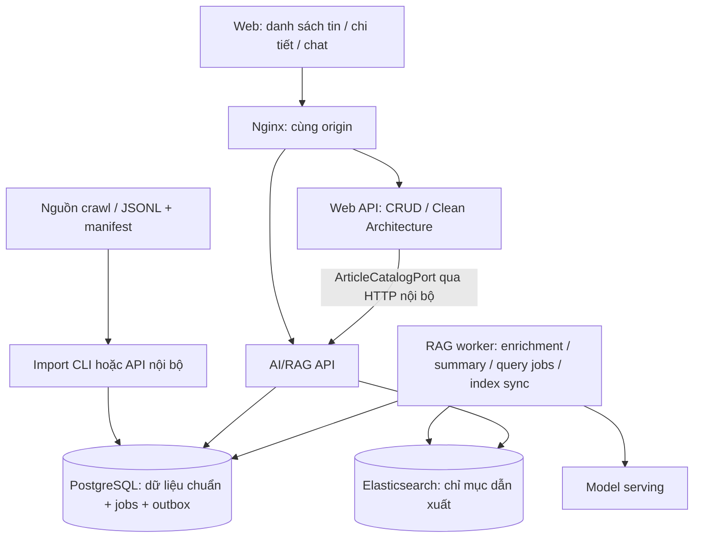

# EventLens — thiết kế web tin tức, tóm tắt và hỏi đáp

Ngày: 2026-10-29. Trạng thái: **đề xuất để triển khai**, chưa phải tính năng đã có.

Đối chiếu mã tại `.claude/worktrees/rag-search-platform`, đặc biệt `docs/architecture.md`, `rag/presentation/briefing_http.py`, `rag/composition.py`, `rag/infra/postgres/models.py`, `shared/contracts/enrichment.py`, `crud/` và frontend. Các kết quả chất lượng trong hội thoại là bằng chứng benchmark đã báo cáo; lượt thiết kế này không chạy lại benchmark.

## 1. Quyết định kiến trúc

Xây **backend chia module theo nghiệp vụ, triển khai Web API và AI/RAG thành các process riêng trong cùng một monorepo**:

- Web: React/Vite hiện có, tổ chức theo tính năng đọc tin, chi tiết bài, chat.
- Web API: mở rộng `backend/crud`, áp dụng Clean Architecture.
- AI/RAG API và worker: giữ `backend/rag`, áp dụng Hexagonal Architecture + LangGraph workflows.
- PostgreSQL + SQLAlchemy + Alembic: dữ liệu chuẩn, phiên bản bài, tác vụ, kết quả AI và hội thoại.
- Elasticsearch: chỉ mục dẫn xuất có thể dựng lại; chưa là điều kiện để đọc tin được.
- Một reverse proxy cùng origin cho frontend và các API.

Đây là lựa chọn phù hợp với code và quy mô hiện tại, không phải tuyên bố kiến trúc tối ưu cho mọi tải. Tên “modular monolith” mô tả được cách tổ chức code cũ, nhưng khi chạy hai API độc lập cần nói rõ mô hình triển khai nhiều process. Không tách mỗi layer thành một service.



Mũi tên là quan hệ sử dụng, không phải mọi thao tác đều chạy đồng bộ. Worker nhận tác vụ bền vững từ PG; import ghi dữ liệu và outbox trong một transaction.

### Phân quyền sở hữu dữ liệu

| Module | Sở hữu | Cách module khác sử dụng |
|---|---|---|
| `rag` | Bài chuẩn/phiên bản, provenance, metadata AI, taxonomy liên quan nội dung, tóm tắt, chunks, chỉ mục, hội thoại và lần trả lời | API nội bộ hoặc public DTO; không import ORM chéo |
| `crud` | Use case web; sau này có hồ sơ người dùng, bookmark, bộ lọc đã lưu | `ArticleCatalogPort` đọc dữ liệu bài qua adapter HTTP tới RAG |
| `event_pipeline` | Luồng sự kiện thử nghiệm hiện có | Giữ nguyên; không mặc định coi là crawler hay bộ gom story đã hoàn thiện |
| `shared/contracts` | DTO ổn định dùng giữa các module | Không chứa repository, model client hoặc logic nghiệp vụ |

**Quyết định ngắn hạn:** giữ bài viết thuộc RAG vì đó là chủ sở hữu hiện tại. CRUD không mở connection để ghi trực tiếp các bảng RAG. HTTP nội bộ thêm một hop nhưng tránh di chuyển hàng loạt dữ liệu chỉ để làm màn hình danh sách. Nếu catalog trở thành miền nghiệp vụ lớn, tách ownership bằng ADR riêng; chưa tạo bản sao catalog thứ hai trong CRUD.

## 2. Hiện có và phần cần bổ sung

| Phần | Hiện trạng quan sát | Cần làm |
|---|---|---|
| CRUD API | Chỉ `/health` | List/detail/facets/taxonomy API |
| Web | Briefing workspace và citation viewer | Feed, filters, article page, navigation, conversation UI |
| Bài viết | PostgreSQL, version/provenance, import và cập nhật | Catalog query cấp bài, trạng thái xử lý rõ ràng |
| Metadata | Contract topic/entity/location và lifecycle enrichment | Provider thật, locality chuẩn hóa, danh mục phục vụ UI |
| Tóm tắt | Có `summary_source` upstream; chưa tương đương tóm tắt AI riêng | Workflow một bài, cache theo version, nguồn cho từng ý |
| Retrieval | PostgreSQL mặc định, ES hybrid opt-in | Reuse; mở rộng scope bài/địa phương xuyên suốt pipeline |
| Chat | `POST /briefing` một lượt; composition mặc định fake | Conversation, run bền vững, adapter sinh đáp án thật |
| Quyền | Có CallerResolver, mặc định caller fixture | Session/principal thật và kiểm quyền theo tài nguyên |

Request `/briefing` hiện nhận query, ngày đăng, source_domains, topic_filters, entity_ids, budget và result_limit. **Chưa có article scope hoặc location filter công khai.** Không thể chỉ thêm nút trên frontend rồi coi hai tính năng này đã được hỗ trợ.

## 3. Các layer bổ sung và trách nhiệm

1. **Catalog:** đọc danh sách, chi tiết, bộ lọc, phân trang. Không gọi LLM.
2. **Taxonomy và geography:** tên chủ đề/địa phương ổn định, alias, quan hệ cha–con, gán nhãn có provenance.
3. **Article summary:** tạo và lưu tóm tắt một phiên bản bài ở background.
4. **Conversation:** quản lý lịch sử, scope, thứ tự lượt hỏi, idempotency và trạng thái chạy.
5. **Query scope:** giao giữa bộ lọc người dùng với quyền thực tế; áp dụng trước retrieval, sau retrieval và khi xem nguồn.
6. **Operations:** theo dõi import, độ trễ indexing, job thất bại, latency, token và lỗi nguồn.

Catalog và conversation là application use case thông thường. Chỉ luồng AI nhiều bước cần đi qua LangGraph.

```text
src/backend/
  crud/
    domain/
    application/
      use_cases/{list_articles,get_article,get_article_summary,list_facets}.py
      ports/article_catalog.py
    presentation/{articles,taxonomy,facets}.py
    infra/rag_catalog_http.py
    composition.py
  rag/
    domain/                         # version, scope, taxonomy, summary, conversation
    application/
      ports/                        # catalog, summary, conversation, job, model ports
      use_cases/                    # catalog queries, summary requests, chat runs
    workflows/
      ingestion/                    # hiện có
      query/                        # hiện có, thêm scope/history có kiểm soát
      summarization/                # mới: state/context/nodes/routes/graph/workflow
    presentation/
      briefing_http.py              # giữ contract cũ
      catalog_http.py               # /internal/v1/catalog/*
      conversations_http.py         # /api/v1/conversations và runs
    infra/                          # SQLAlchemy, ES, model, job implementations
    composition.py
  shared/contracts/
src/frontend/web/src/
  news/                             # danh sách, filters, facets, pagination
  article/                          # chi tiết, summary, source link
  chat/                             # conversation, scope, run state
  briefing/                         # tái sử dụng citation/client contract hiện có
```

Đây là cây đề xuất, không yêu cầu tạo trước tất cả thư mục rỗng. Architecture tests cần cho phép SQLAlchemy trong `crud/infra` nếu sau này CRUD có bảng riêng; hiện quy tắc chỉ cho `rag/infra` không tự động phù hợp với mọi module mới.

## 4. Tổ chức dữ liệu

Tên dưới đây là logical model đề xuất, không yêu cầu đổi tên bảng hiện tại.

| Nhóm | Trường quan trọng | Quy tắc |
|---|---|---|
| Article | article_id, current_version_id, source_id, canonical_url, tombstone | Một định danh logic xuyên các lần cập nhật |
| ArticleVersion | version_id, article_version_id upstream, title, content_nfc, content_hash, published_at, fetched_at, parser_version, normalization_version | Nội dung đã dẫn nguồn phải gắn version cụ thể; không sửa đè |
| Topic | topic_id/code, tên hiển thị, parent_id, taxonomy_version | Mở rộng enum hiện tại theo contract/version; không tự thay các giá trị đã đóng băng |
| Location | location_id, canonical_name, type, parent_id, aliases, thời gian hiệu lực khi cần | Địa phương được nói tới trong bài, không phải trụ sở tòa soạn; giữ được cách gọi lịch sử |
| Article annotations | article_version_id, topic/location IDs, provenance, confidence, evidence spans, review status | Nhiều nhãn/bài; unknown hợp lệ; override người duyệt không bị model ghi đè |
| ArticleSummary | article_version_id, text, key_points, supporting spans, status, model/prompt/schema versions | AI summary khác `summary_source`/sapo do báo cung cấp |
| Chunk/index | article_id, version_id, offset, text hash, chunker/embedding identity | Truy ngược được đúng lát cắt; giữ fence/version guards |
| Conversation | id, owner_id/session_id, scope_definition, scope_hash, created_at | Scope không đổi âm thầm theo UI |
| Message / QueryRun | conversation_id, sequence, run_id, question, status, answer, citations, evidence versions, usage, timestamps | Kết quả và lỗi đều được lưu; retry không tạo trùng lượt |
| Jobs/outbox | job identity, revision, state, lease, attempts, next_retry_at | Tác vụ chạy lại phải idempotent; completion chỉ publish nếu revision còn phù hợp |

Topic/location có thể giữ JSON evidence hiện tại và thêm bảng quan hệ dẫn xuất để lọc hiệu quả. Không làm mất nhãn gốc hoặc rewrite lịch sử. Metadata chưa sẵn sàng phải hiện “chưa phân loại”, không âm thầm biến mất khỏi toàn bộ feed.

### Cấp bài và cấp đoạn

- Feed, counts và facets: **một kết quả cho một article_id hiện hành**. Ban đầu dùng query/index PG cấp bài.
- Retrieval: nhiều chunk có offset/version, chọn evidence theo ngân sách.
- Nếu đưa feed sang ES sau này: projection cấp bài riêng; không lấy số chunk làm số bài.
- Summary và embedding không dùng chung identity cache: mỗi loại cần đúng input version và model/prompt hoặc embedding fingerprint tương ứng.

### Khi bài mới hoặc sửa/xóa

```text
validate input → normalize có phiên bản → persist article/version + job/outbox
  → bài đọc được ngay, trạng thái metadata/summary = pending
  → enrichment và summary chạy độc lập
  → validate output + kiểm revision hiện hành → publish derived results
  → outbox đồng bộ search projection → reconcile
```

Một job chậm của revision cũ không được publish thành kết quả hiện hành. Lỗi enrichment không làm bài biến mất khỏi lexical feed. Tombstone phải chặn detail, retrieval và source viewer ngay tại PG, kể cả ES chưa kịp xóa.

Transactional outbox giải quyết việc ghi DB và phát thay đổi không đồng bộ; consumer vẫn cần xử lý lặp và thứ tự phiên bản. Dự án đã có cơ chế này nên mở rộng trên nó. [AWS: transactional outbox](https://docs.aws.amazon.com/prescriptive-guidance/latest/cloud-design-patterns/transactional-outbox.html).

## 5. Thiết kế retrieval và summary

### Danh sách tin

- Không có từ khóa: sort `published_at DESC NULLS LAST`, khóa phụ ổn định `article_id`; không lấy fetched_at giả làm published_at.
- Có từ khóa: lexical cấp bài và bộ lọc; trả tên chế độ tìm kiếm nếu fallback.
- Phân trang bằng cursor gắn filter/sort hash và thời điểm truy vấn; reset cursor khi đổi filter.
- PG cursor không đảm bảo snapshot bất biến khi bài bị sửa/xóa. MVP chấp nhận feed cập nhật và báo có tin mới, không giữ transaction DB qua nhiều HTTP request.
- Nếu sau này yêu cầu snapshot ổn định khi search ES, dùng PIT + search_after với TTL; ES xác nhận refresh giữa các trang có thể đổi thứ tự. [Elastic: pagination](https://www.elastic.co/docs/reference/elasticsearch/rest-apis/paginate-search-results).

### Hỏi đáp

```text
resolve caller + scope
  → tạo câu hỏi độc lập từ lịch sử liên quan
  → retrieve trong scope
  → fuse/dedup theo policy hiện tại
  → select evidence theo budget
  → kiểm version, quyền, tombstone từ PG
  → synthesize
  → validate claims/citations
  → lưu kết quả rồi trả UI
```

- PostgreSQL giữ mặc định; BM25 + BGE-M3, RRF k=60, trọng số 1:1 là cấu hình hybrid opt-in/shadow.
- Chưa bật cap=5/fill6, reranker, freshness boost hoặc multi-hop mặc định. Việc làm web không tự cho phép đổi cấu hình benchmark.
- BGE-M3 1024 chiều thuộc search projection; không ép vector(1536) PG hiện tại thành 1024 trong task web.
- Lịch sử chat chỉ giúp hiểu “bài này”, “còn địa phương kia”; đáp án cũ không tự trở thành nguồn sự thật cho lượt mới.
- Có thể lưu lịch sử trong PG rồi truyền phần liên quan vào graph một lượt. Chưa cần checkpointer. LangGraph checkpointer lưu state theo thread và hữu ích khi cần resume giữa node; đó là quyết định vận hành riêng. [LangGraph: persistence](https://docs.langchain.com/oss/python/langgraph/persistence).

### Tóm tắt một bài

Đọc đúng một ArticleVersion → chọn/bao phủ nội dung theo budget → tóm tắt → kiểm evidence từng ý → lưu. Không chạy global retrieval để tóm tắt bài đang mở. Nếu bài dài vượt context, xử lý theo section trong workflow hoặc trả trạng thái giới hạn; không âm thầm cắt đầu bài rồi tuyên bố tóm tắt toàn bộ.

Đề xuất đầu ra: một đoạn ngắn + 3–5 ý chính, mỗi ý gắn supporting span. Validation offset/hash chỉ chứng minh nguồn tồn tại; độ hỗ trợ ngữ nghĩa vẫn phải đánh giá riêng.

Worker xử lý summary và query jobs ở hàng đợi ưu tiên riêng, tránh import hàng trăm bài chặn chat. Tận dụng jobs/lease PG trước; chưa cần thêm Kafka/Celery/Redis. Tác vụ model không đặt vào `BackgroundTasks` không bền vững của web process; tài liệu FastAPI cũng phân biệt tác vụ nhẹ và tính toán nặng cần worker riêng. [FastAPI: background tasks](https://fastapi.tiangolo.com/tutorial/background-tasks/).

## 6. Public API cho MVP

Tất cả endpoint dưới đây là **mới/đề xuất**, ngoại trừ hai route `/briefing` ghi riêng ở cuối. Prefix `/api/v1` là namespace public qua Nginx, không có nghĩa cùng một service xử lý mọi route.

### Web API — `crud-api`

| Method | Endpoint | Công dụng |
|---|---|---|
| GET | `/api/v1/articles` | Feed/search cấp bài, filters, cursor |
| GET | `/api/v1/articles/{article_id}` | Chi tiết bản hiện hành, source, tags, processing status |
| GET | `/api/v1/articles/{article_id}/summary` | Summary hiện hành hoặc pending/failed/unavailable |
| GET | `/api/v1/article-facets` | Counts chủ đề/địa phương/nguồn trong phạm vi lọc |
| GET | `/api/v1/topics` | Danh mục chủ đề, tên hiển thị |
| GET | `/api/v1/locations` | Tìm địa phương, lấy con theo parent_id |
| GET | `/api/v1/sources` | Danh sách nguồn báo |

`GET summary` chỉ đọc trạng thái/kết quả, không tự gọi model. Summary được lên lịch lúc ingest/update; retry/regenerate là command quản trị.

### AI/RAG API — `rag-api`

| Method | Endpoint | Công dụng |
|---|---|---|
| POST | `/api/v1/conversations` | Tạo hội thoại và cố định scope |
| GET | `/api/v1/conversations` | Các hội thoại của caller hiện tại |
| GET | `/api/v1/conversations/{id}/messages` | Lịch sử phân trang, kèm scope/header hội thoại |
| POST | `/api/v1/conversations/{id}/runs` | Nhận câu hỏi, tạo tác vụ, trả 202 |
| GET | `/api/v1/runs/{run_id}` | Lấy tiến độ/kết quả/lỗi; MVP polling |
| POST | `/api/v1/runs/{run_id}/cancel` | Yêu cầu hủy cooperative; không hứa dừng model tức thì |
| DELETE | `/api/v1/conversations/{id}` | Xóa hội thoại theo retention policy, hủy run pending |
| GET | `/briefing/sources/{source_ref}` | **Đã có**: mở nguồn, tiếp tục kiểm quyền/version/hash/span |
| POST | `/briefing` | **Đã có**: giữ tương thích use case một lượt; không tự đổi contract v1 |

SSE `GET /api/v1/runs/{run_id}/events` có thể thêm sau polling. Stream tiến độ và kết quả đã validate; không stream JSON thô của model rồi coi là câu trả lời đã kiểm. SSE hỗ trợ server đẩy sự kiện về browser; proxy phải cấu hình timeout/buffering phù hợp. [FastAPI: SSE](https://fastapi.tiangolo.com/tutorial/server-sent-events/).

### Routing

- `/api/v1/articles*`, `/api/v1/article-facets`, `/api/v1/topics`, `/api/v1/locations`, `/api/v1/sources` → CRUD.
- `/api/v1/conversations*`, `/api/v1/runs*`, `/briefing*` → RAG.
- `/internal/*` không expose qua public Nginx.
- `/` và các route UI → SPA. Cập nhật cả Vite proxy và Nginx; kiểm bằng HTTP qua cổng web, không chỉ gọi trực tiếp API.

## 7. Contract quan trọng

### Danh sách và bộ lọc

Ví dụ:

```http
GET /api/v1/articles?topic_ids=transportation&location_ids=loc-hcm&published_after=2026-10-28T17:00:00Z&published_before=2026-10-29T17:00:00Z&sort=latest&limit=20
```

Các ID ví dụ là minh họa; dùng identifier thực từ taxonomy API. `topic_ids`, `location_ids`, `source_ids` dùng query parameter lặp cho nhiều giá trị. OR trong một loại, AND giữa các loại. Parent location bao gồm con khi `include_descendants=true`.

Time window là `[after, before)`, ISO-8601 có timezone, lưu UTC. Client chuyển ngày lịch theo `Asia/Ho_Chi_Minh`; không so chuỗi ngày thiếu timezone. Nội dung không có ngày đăng vẫn thấy ở feed tổng, không khớp time filter trừ khi người dùng chọn riêng.

```json
{
  "items": [{
    "article_id": "article-123",
    "article_version_id": "version-2",
    "title": "Tiêu đề bài",
    "source": {"id": "source-1", "name": "Nguồn báo", "url": "https://example.com/article"},
    "published_at": "2026-10-29T01:30:00Z",
    "topics": [{"id": "transportation", "name": "Giao thông"}],
    "locations": [{"id": "loc-hcm", "name": "TP. Hồ Chí Minh"}],
    "summary_preview": null,
    "processing": {"metadata": "ready", "summary": "pending"}
  }],
  "next_cursor": "opaque-cursor",
  "has_more": true,
  "as_of": "2026-10-29T03:00:00Z"
}
```

Không đưa toàn văn mọi bài vào list response. Detail trả plain text đã chuẩn hóa nếu được phép hiển thị, hoặc chỉ summary + link gốc. Summary response luôn có version, status, nguồn gốc (`ai`/`publisher`) và citation của key points khi là AI summary. Không giả dùng sapo làm summary AI trong lúc pending.

### Facets

MVP counts áp dụng **mọi filter đang chọn**, đếm article_id hiện hành khác nhau trong scope được phép. Chưa làm self-excluding facets để tránh mơ hồ. Sau này muốn hiển thị số lựa chọn của từng chiều sau khi bỏ riêng chiều đó phải ghi rõ contract.

Không đặt access filter ở ES `post_filter`: `post_filter` chỉ lọc hits, không lọc aggregations; có thể lộ counts. Nếu dùng ES, quyền nằm trong query filter chung cho cả hits và facets. [Elastic: filter search results](https://www.elastic.co/docs/reference/elasticsearch/rest-apis/filter-search-results).

### Scope của hội thoại

Ba loại scope:

1. `all`: mọi bài caller được phép đọc.
2. `filtered`: cả tập thỏa bộ lọc, không phải 20 bài trang đang xem.
3. `articles`: danh sách article_id được chọn; tùy chọn version pin để hỏi đúng bài đang đọc.

```json
{
  "scope": {
    "type": "filtered",
    "filters": {
      "topic_ids": ["transportation"],
      "location_ids": ["loc-hcm"],
      "source_ids": [],
      "published_after": "2026-10-28T17:00:00Z",
      "published_before": "2026-10-29T17:00:00Z"
    }
  }
}
```

Nếu feed có từ khóa, UI phải nói rõ có đưa từ khóa vào scope hay không; nếu có, backend dùng lại cùng semantics tìm catalog, không truyền danh sách trang đầu thành toàn bộ scope. Chọn phạm vi xong, UI hiển thị chip “Giao thông · TP.HCM · 29/10”. Đổi filter bên ngoài không đổi hội thoại đang có; người dùng tạo hội thoại mới hoặc xác nhận đổi phạm vi bằng một tính năng riêng sau này.

Scope được đóng băng về **định nghĩa filter**, không mặc định đóng băng toàn bộ corpus. Mỗi run lấy trạng thái hiện hành, ghi as_of và version nguồn đã dùng. Quyền luôn kiểm lại, không đóng băng theo lúc tạo conversation. Với article pin đã đổi bản, trả `scope_stale` để UI xin chuyển sang bản mới; không âm thầm lấy một bản khác.

### Chạy một câu hỏi

```http
POST /api/v1/conversations/{id}/runs
Idempotency-Key: <client-generated-uuid>
Content-Type: application/json

{"question":"Có những thay đổi giao thông nào cần lưu ý?"}
```

Trả `202` với `run_id`, `status=queued`, `status_url`. Chỉ một run active/conversation ở MVP; submit thêm trả 409. Khóa idempotency gắn caller + conversation + body hash; retry cùng body trả run cũ, khác body trả 409. Transaction tạo message/run/job không được tách rời.

`GET run` trả trạng thái `queued/running/completed/failed/cancelled`; `completed` còn có outcome `answered/abstained`. Không đánh đồng không có evidence với lỗi provider. Answer gồm claims, citations, uncertainties, effective_scope và as_of. Error envelope chỉ có code an toàn và request_id.

Client đóng tab không xóa job; mở lại đọc run tiếp. Timeout model, deadline tác vụ, lease/retry và client disconnect là các trạng thái khác nhau. Hủy không đảm bảo API provider ngừng tính phí ngay.

### Lưu citation dài hạn

Source ref hiện có là token tạm thời. Lưu conversation phải lưu citation identity/version/span và quyền sở hữu, không chỉ URL chứa source_ref. Khi mở lại lịch sử có thể phát ref mới sau khi kiểm quyền; không kéo dài token vô hạn. Giữ hành vi source viewer hiện tại: ref không tồn tại → 404, nguồn đổi/xóa → 410, quyền bị thu hồi → 403. Hiển thị lịch sử không được âm thầm thay nguồn cũ bằng bài mới. Muốn mở nguồn lịch sử phải có contract/version endpoint riêng.

## 8. API nội bộ, quản trị và vận hành

### Cần cho kết nối giữa hai API

RAG cung cấp `/internal/v1/catalog/articles`, `/articles/{id}`, `/articles/{id}/summary`, `/facets`, `/topics`, `/locations`, `/sources` dưới cùng prefix catalog. CRUD adapter gọi các endpoint này và map DTO. Đây là một backend catalog với một tập quy tắc filter, không xây hai bộ xử lý filter độc lập.

HTTP nội bộ phải có xác thực service và principal được kiểm chứng. Không tin `X-User-ID` do browser tự gửi. Deadline và circuit breaker ngắn cho catalog; catalog timeout trả 503 có retry, không trả danh sách rỗng giả.

### Import dữ liệu

Ban đầu giữ CLI JSONL + manifest để không mở rộng phạm vi task web. Khi cần tích hợp crawler online, bổ sung:

| Method | Endpoint nội bộ | Ý nghĩa |
|---|---|---|
| POST | `/internal/v1/ingestion-batches` | Nhận upload hoặc object reference thuộc storage cho phép, trả 202 |
| GET | `/internal/v1/ingestion-batches/{id}` | Số bài nhận/từ chối/duplicate, validation errors, trạng thái |

Không fetch URL tùy ý từ browser. Giữ idempotency, rollback và provenance của importer đang có. `event_pipeline` không thay importer này.

### Quản trị — làm sau luồng người đọc

- `POST /internal/v1/articles/{id}/summary-jobs`: retry/regenerate, yêu cầu expected_version.
- `PATCH /internal/v1/articles/{id}/annotations`: chỉnh topic/location, ghi reviewer và audit, optimistic concurrency.
- Index rebuild/reconcile/health: dùng CLI hiện tại trước, chưa cần mở public HTTP.
- Mỗi service có liveness/readiness; log request_id/run_id, index lag, queue age, retry/dead-letter, latency/token, lỗi source_stale và scope violations.

### Người dùng và quyền

Feed public có thể đọc không đăng nhập nếu corpus được công bố. Chat/history cần owner từ session thật hoặc tài khoản; không dùng caller fixture chung cho nhiều người. Chọn session/OIDC với hệ thống đăng nhập trước khi chốt login endpoints. Không thêm bộ tự xây password/JWT chỉ để đủ danh sách API.

Private corpus cần quyền theo tài nguyên xuyên list, count, detail, chat và citations. Đây là phần mới, không được coi scope của benchmark là ACL sản phẩm đã xong. Text báo là dữ liệu không tin cậy, không được biến thành lệnh thay scope hay tool instruction.

## 9. Thứ tự triển khai và nghiệm thu

### P0 — chốt hợp đồng và nền dữ liệu

- Chụp baseline code đã review; không trộn các thí nghiệm retrieval chưa chốt vào mặc định.
- Chốt ArticleCard, ArticleDetail, SummaryView, CatalogFilters, ConversationScope và error DTO.
- Chốt taxonomy/locality IDs và luật thời gian; migration tăng dần theo head thực tế, không hardcode tên revision tiếp theo trong tài liệu.
- Tạo DB development riêng, import corpus thật theo quy trình hiện có; không trỏ UI vào DB benchmark sắp bị cleanup.

### P1 — danh sách và chi tiết bài

- Catalog PG + internal API + CRUD adapter/public routes + frontend feed/detail.
- Filter source/ngày trước, topic/location hiển thị đúng trạng thái nếu chưa có nhãn.
- E2E: bài mới xuất hiện; lọc đúng; pagination không nhân kết quả vì chunk; sửa/xóa được phản ánh; API unavailable hiện lỗi.
- Nginx/Vite proxy test qua cùng origin; không chỉ test direct API.

### P2 — metadata và tóm tắt thực

- Kết nối enrichment/summarization provider thật bằng adapter, giới hạn concurrency và deadline.
- Tóm tắt được lưu theo đúng version, không gọi model lại mỗi lần mở bài.
- E2E: pending → ready; job revision cũ không publish; failed có trạng thái; excerpt đúng offset; kiểm tay các lỗi ngày/tên/số liệu trên mẫu.

### P3 — chat có scope và lịch sử

- Conversation/run/worker + real synthesis adapter + UI polling, sau đó mới SSE nếu cần.
- Mở rộng scope article/location qua request → domain → PG/ES → final check → viewer, giữ legacy `/briefing`.
- E2E ba scope; chống cross-user history; retry không tạo hai run; reload tab lấy lại kết quả; no-answer khác provider failure.
- Câu hỏi một bài không được dẫn bài ngoài scope. Bài bị sửa giữa lượt phải xử lý stale theo contract.

### P4 — nghiệm thu sản phẩm và hiệu năng

- Bộ câu hỏi người dùng và nhãn được người duyệt; đo đủ ý, claim support, sai ngày/tên, false abstention, latency.
- Load test feed/chat riêng; quan sát ảnh hưởng batch import lên chat và index lag.
- Đề xuất mục tiêu ban đầu để xác nhận: feed/detail p95 ≤ 500 ms ở tải xác định; answer p95 ≤ 15 s sau khi chọn hạ tầng model. Đây là mục tiêu, không phải kết quả đã đạt.
- LLM CPU ở benchmark hiện mất hàng chục giây đến hơn một phút: asynchronous API/SSE chỉ cải thiện trải nghiệm chờ, không giải quyết thời gian suy luận. Cần chọn serving/model/hardware theo phép đo mới.
- Chỉ cân nhắc đổi retrieval mặc định qua đánh giá riêng. Website không phụ thuộc việc cap=5 có thắng hay không.

## 10. Những quyết định chưa cần mở rộng ngay

Chưa bổ sung GraphRAG, agent tự chọn tool, story grouping, event timeline, recommendation cá nhân hóa hoặc microservice cho từng layer. Chưa dựng broker riêng nếu PG jobs đáp ứng tải. Các tính năng này chỉ nên có khi use case và phép đo chỉ ra nhu cầu.

Tài liệu này đề xuất cấu trúc và contract để giao việc; chưa triển khai endpoint, chưa migrate DB, chưa thay đổi production hay default retrieval.
